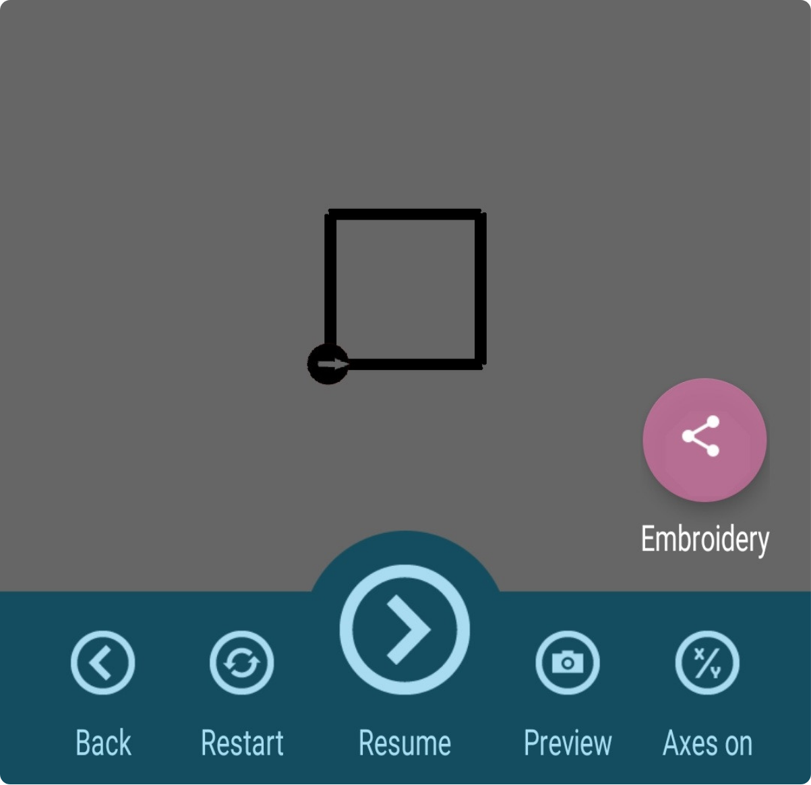

Tässä ohjeessa opit tallentamaan ja jakamaan valmiit kuviosi mobiililaitteellasi.

Tätä varten tarvitset valmiin brodeerauskuvion, jonka haluat viedä. Jos sinulla ei vielä ole sellaista, hae inspiraatiota [brodeerausohjeistamme](index.md)!

*Voit ladata tämän ohjeen PDF-muodossa*:

[Vie kuviot](../../../media/embroidery-tutorials/Export-Designs.pdf)

### 1. Käynnistä projekti ja odota, kunnes se on kokonaan auki. Muuten kuvio jää vajaaksi.

### 2. Napauta takaisin-painiketta ja paina jakopainiketta.

### 3. Jaa brodeerustiedostosi sähköpostitse tai tallenna se puhelimeesi.

Jakotoiminto voi näyttää hieman erilaiselta eri puhelimissa.

Brodeeraustiedostosi tallentuu DST-tiedostona.

Brodeerauskone tuntee tämän tiedostomuodon ja brodeeraa kuvion kankaallesi.
