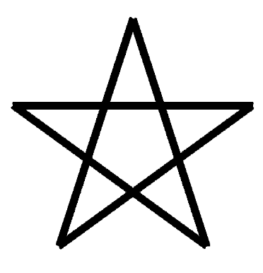

Tässä ohjeessa opit brodeeraamaan tähden siksak-pistolla (58,2 x 61,2 mm).

Sinun pitää jo osata luoda uusi objekti ja lisätä siihen palikoita. Katso tarvittaessa ohjeet [Aloitussarjasta](../../game-tutorials/starter-tutorials/index.md). Lisäksi brodeerauspalikoiden pitää olla jo käytössä. Tämän voit tarkistaa **[Ota brodeerauspalikat käyttöön](activate-embroidery-bricks.md)**-ohjeesta.

Lisätietoja tai kuviovinkkejä saat muista ohjeista.

*Voit ladata tämän ohjeen PDF-muodossa*:

[Tähti siksak](../../../media/embroidery-tutorials/Star-ZigZag.pdf)

### 1. Luo uusi brodeerausobjekti (katso [Luo brodeerausobjekteja](create-embroidery-objects.md)).

### 2. Aloita ja lisää palikat skriptiisi askel kerrallaan.

### 3. Aloita kuviosi napauttamalla toistopainiketta!
