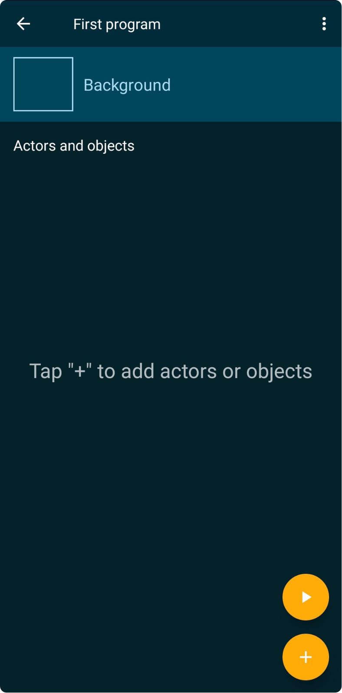

Tässä ohjeessa opit luomaan uuden objektin projektiisi ja näet, mitä vaihtoehtoja sinulla on.

Tätä varten sinulla pitää jo olla ladattuna Pocket Code -sovellus ja tiedettävä, miten luodaan uusi projekti. Jos tarvitset apua, katso ohje **[Uusi projekti](new-project.md)**.

*Voit ladata tämän ohjeen PDF-muodossa:*

[Uusi objekti](../../../media/game-tutorials/New-Object.pdf)

### 1. Luo uusi objekti

Ensin sinun pitää avata uusi projektisi.

Löydät sen Pocket Coden aloitusnäytöltä. Jos sinulla on useampia projekteja, napauta kohtaa „Laitteen projektit“. Valitse sitten uusi projektisi. Jos et ole vielä luonut uutta projektia tai tarvitset lisätietoja siitä, katso ohje **[Uusi projekti](new-project.md)**.

### 2. Luo uusi objekti

Nyt voit luoda uuden objektin. Napauta siihen oikeassa alakulmassa olevaa keltaista plus-painiketta. Näet uuden ikkunan, jossa on seitsemän vaihtoehtoa.

### 3. Luontitavat

Nämä ovat vaihtoehdot, joista voit valita:

### 4. Piirrä kuva

Jotta aloittaminen on mahdollisimman helppoa, käytämme toimintoa „Piirrä“ ja piirrämme vain pisteen. Kun olet piirtänyt pisteen Pocket Paintilla, voit lopettaa (mene yksi askel taaksepäin).

### 5. Anna nimi

Nyt sinun pitää antaa kuvallesi nimi.

### 6. Sijoita objekti

Sen jälkeen sinun pitää sijoittaa objekti visuaalisesti siirtämällä sitä sormella vasemmalle, oikealle, ylös tai alas. Tallenna se painamalla oikeassa yläkulmassa olevaa painiketta.

### 7. Onnistuit! Loit oman uuden objektin.

Nyt sinulla on projekti, jossa on objekti, jota voit ohjelmoida!

Sitä varten sinun pitää tietää, mitä palikoita on saatavilla. Ohje **[Ensimmäiset palikat](first-bricks.md)** antaa hyvän yleiskuvan palikkakategorioista. Voit kuitenkin myös aloittaa suoraan ensimmäisellä projektillasi. Valitse sopiva ohje Aloittelijan-sarjasta.
