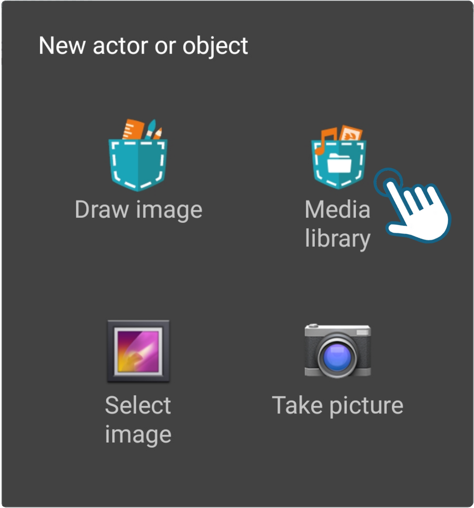

Neste tutorial, aprenderás a crear obxectos con que podes bordar os teus patróns.

Para este tutorial, xa debes saber como crear un proxecto. Consulte os tutoriais do [Série de inicio](../../game-tutorials/starter-tutorials/index.md), se precisa de axuda.

Para máis información ou suxestións de deseño, non te preocupes en consultar os outros tutoriais.

*Aquí podes descargar o tutorial en PDF-formato*:

[Crea obxectos de bordado](../../../media/embroidery-tutorials/Create-Embroidery-Objects.pdf)

### 1. Fai clic no botón máis na parte inferior dereita do teu proxecto para engadir un novo obxecto.

### 2. Para seleccionar unha imaxe, vai á biblioteca de medios.

### 3. Un obxecto de bordado representa un nivel da agulha da máquina de bordar.

Podes seleccionar o teu obxecto dependendo da cor que desexes.

Desplome e busca a flecha que se encaixa.

### 4. Dar un nome e imprimir o novo obxecto Aceptar.

### 5. Agora creou un novo obxecto. Agora pode engadir un guión e programar o obxecto.

Agora sabes como crear un obxecto. Engade un novo obxecto para cada cor que desexe usar.

Podes engadir un guión en cada cor e programar os teus propios deseños e incluso bordalo máis tarde.

Necesitas inspiración ou axuda? Mirade os nosos outros tutoriais!
