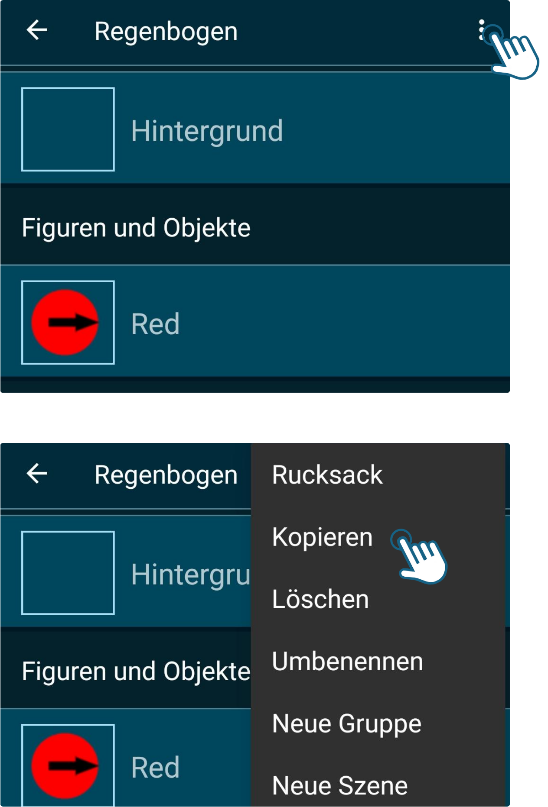

Neste tutorial, aprenderás a bordar un arco iris (112 x 57,2 mm).

Xa debes saber o que é un bucle e como funciona.

O **[Semicírculo](../embroidery-tutorials-beginner/semicircle.md)**-tutorial pode ser útil para este tutorial.

Executar o libro de bordados da serie [Principiante](../embroidery-tutorials-beginner/index.md) se aínda non tes bordado nada.

Para máis información ou suxestións de deseño, consulte os outros tutoriais.

*Aquí podes descargar o tutorial en PDF-formato*:

[Arcoiris](../../../media/embroidery-tutorials/Rainbow.pdf)

### 1. Crea un novo obxecto de bordado (ver [Crea obxectos de bordado](../embroidery-tutorials-beginner/create-embroidery-objects.md)):

### 2. Insertar o seguinte guión:

### 3. Copia obxecto

Para o seguinte arco maior, podes simplemente copiar o obxecto que acabaste de crear.

Fai clic nos tres puntos na esquina superior dereita da visión xeral do obxecto.

Entón vai a «Copiar» e seleccione o obxecto.

Se usa un obxecto separado para cada arco, máis tarde pode bordalos en diferentes cores.

### 4. Adapta obxecto

Para asegurar que os arcos sexan agora de diferentes tamaños, necesitamos cambiar algúns valores.

Para facelo, vai ao guión do obxecto copiado e ajusta os seguintes valores:

### 5. Repita os pasos 3 e 4 para máis arcos!

### 6. Toque a xogo para comezar o deseño!
