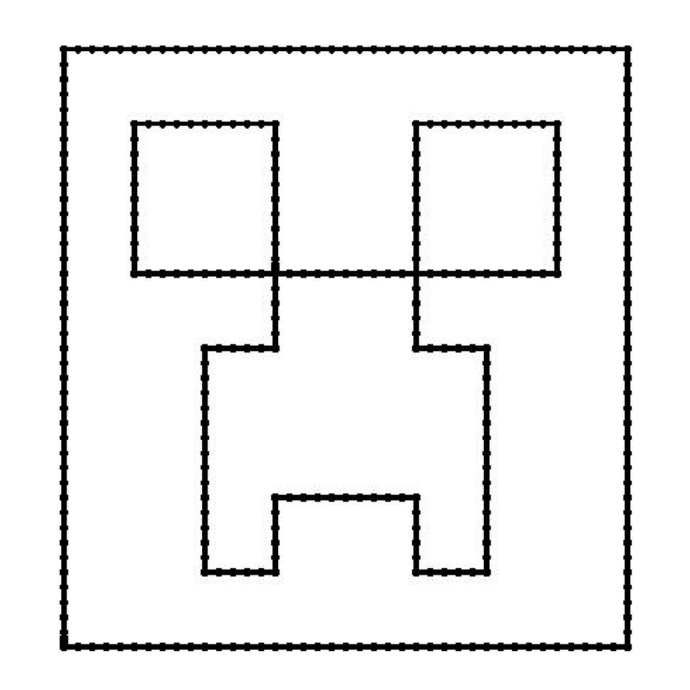

આ ટ્યુટોરીયલમાં, તું શીખશો કે કેવી રીતે માઇનક્રાફ્ટ (80 x 80mm) માંથી ક્રિપરને ગૂંથવું.

તમારે પહેલેથી જ જાણવું જોઈએ કે લૂપ શું છે અને તે કેવી રીતે કાર્ય કરે છે.

આ ટ્યુટોરીયલ માટે **[ચોરસ](../embroidery-tutorials-beginner/square.md)**-ટ્યુટોરીયલ મદદરૂપ થઈ શકે છે.

જો તું હજી સુધી કશું જ ગૂંથ્યું નથી તો [શરુઆત](../embroidery-tutorials-beginner/index.md) શ્રેણીમાં ગૂંથણ ટ્યુટોરિયલ્સ પર એક નજર નાખો.

વધુ માહિતી અથવા ડિઝાઇન સૂચનો માટે અન્ય ટ્યુટોરિયલ્સ તપાસો.

*અહીં તું ટ્યુટોરીયલ ડાઉનલોડ કરી શકે છે PDF-ફોર્મેટ*:

[ક્રિપર-Minecraft-en](../../../media/embroidery-tutorials/Creeper-Minecraft-en.pdf)

### 1. નવી ભરતકામ પદાર્થ બનાવો (જુઓ [ભરતકામ વસ્તુઓ બનાવો](../embroidery-tutorials-beginner/create-embroidery-objects.md)) અને નીચેના સ્ક્રિપ્ટ્સ દાખલ કરોઃ:

### 2. ચહેરો

### 3. રૂપરેખા

### 4. તારી ડિઝાઇન શરૂ કરવા માટે રમતને ટેપ કરો!
