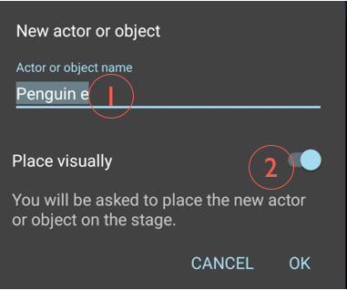

Catrobat મીડિયા લાઇબ્રેરી એ **અભિનેતાઓ**, **પૃષ્ઠભૂમિ**, અવાજો અને વસ્તુઓનો સંગ્રહ છે જેનો તું તારા પ્રોજેક્ટ્સમાં ઉપયોગ કરી શકે છે. તું તારા વિચારોને અનુરૂપ બધું કસ્ટમાઇઝ કરી શકે છે!

[અભિનેતા](#મીડિયા-લાઇબ્રેરી-માંથી-એક-નવો-અભિનેતા-ઉમેરો)

[પૃષ્ઠભૂમિ](#મીડિયા-લાઇબ્રેરી-માંથી-પૃષ્ઠભૂમિ-ઉમેરો)

[અવાજ](#મીડિયા-લાઇબ્રેરીમાંથી-અવાજ-ઉમેરો)

[પદાર્થ](#મીડિયા-લાઇબ્રેરીમાંથી-એક-પદાર્થ-ઉમેરો)

***

### મીડિયા લાઇબ્રેરી માંથી એક નવો અભિનેતા ઉમેરો

પ્રોજેક્ટ દૃશ્યમાં, નવા અભિનેતા અથવા ઑબ્જેક્ટ ઉમેરવા માટે + પ્રતીક [(વધુ માહિતી](../quick-start-guide/add-actors-and-objects.md) પર ટેપ કર. પસંદ કરો “દેખાવ”.

એક અભિનેતા પસંદ કરો કે જે તું તારા પ્રોગ્રામમાં ઉપયોગ કરવા માંગો છો. એક્ટર (1) પર ટેપ કરો અને તેને ડાઉનલોડ કરો (2).

હવે તું અભિનેતાને નવું નામ આપી શકો છો (1) અને તેને તારી રમતમાં દૃષ્ટિની રીતે મૂકી શકો છો (2). આનો અર્થ એ થાય કે તું તારા અભિનેતાને સીધા સ્ક્રીન પર ખસેડી શકો છો. તું તરત જ જોશો કે તે પ્રોજેક્ટમાં ક્યાં સ્થિત છે. “ઠીક છે” સાથે પુષ્ટિ કર.

તારા અભિનેતા (1) ને સ્થાન આપો અને ચેકમાર્ક (2) સાથે પુષ્ટિ કર.

***

### મીડિયા લાઇબ્રેરી માંથી પૃષ્ઠભૂમિ ઉમેરો

પ્રોજેક્ટ દૃશ્યમાં પૃષ્ઠભૂમિ પર જાઓ. દેખાવ વિભાગ પર સ્વિચ કરો અને એક નવું દેખાવ ([વધુ માહિતી](../quick-start-guide/add-background.md) ઉમેરો. “દેખાવ” પર ટેપ કર.

તારા કાર્યક્રમમાં તું જે યોગ્ય પૃષ્ઠભૂમિનો ઉપયોગ કરવા માંગો છો તે પસંદ કર. પૃષ્ઠભૂમિ (1) પર ટેપ કરો અને તેને ડાઉનલોડ કરો (2).

***

### મીડિયા લાઇબ્રેરીમાંથી અવાજ ઉમેરો

તારી પૃષ્ઠભૂમિ અને તારા અભિનેતાઓ અથવા પદાર્થો બંનેમાં અવાજો ઉમેરી શકાય છે. તું જ્યાં અવાજ ઉમેરવા માંગો છો ત્યાં અભિનેતા અથવા પૃષ્ઠભૂમિ પર ટેપ કર. સાઉન્ડ દૃશ્ય પર જાઓ અને + પ્રતીક પર ટેપ કર.

મીડિયા લાઇબ્રેરીને ઍક્સેસ કરવા માટે “અવાજો” પર ટેપ કર.

તારા કાર્યક્રમમાં તું જે યોગ્ય અવાજનો ઉપયોગ કરવા માંગો છો તે પસંદ કર. ધ્વનિ (1) પર ટેપ કરો અને તેને ડાઉનલોડ કરો (2).

***

### મીડિયા લાઇબ્રેરીમાંથી એક પદાર્થ ઉમેરો

Catrobat તને તૈયાર વસ્તુઓ ડાઉનલોડ કરવાની તક આપે છે. વસ્તુઓ વ્યક્તિગત રમત તત્વો છે જેમ કે ડાઉનકાઉન્ટ, જેમાં પહેલાથી જ સ્ક્રિપ્ટ શામેલ છે.

તું અભિનેતાઓ જેવી વસ્તુઓ ઉમેરો છો.

પ્રોજેક્ટ દૃશ્ય માં, નવા પદાર્થ ઉમેરવા માટે + પ્રતીક ([વધુ માહિતી](../quick-start-guide/add-actors-and-objects.md)) ટેપ કર.

પસંદ કરો “લાઇબ્રેરી”.

તું તારા પ્રોગ્રામમાં ઉપયોગ કરવા માંગો છો તે એક પદાર્થ માટે શોધો. પદાર્થ (1) પર ટેપ કરો અને તેને ડાઉનલોડ કરો (2).

હવે તું આઇટમનું નવું નામ આપી શકો છો (1) અને તેને તારી રમતમાં દૃષ્ટિની મૂકી શકો છો (2). આનો અર્થ એ કે તું તારી વસ્તુને સીધી સ્ક્રીન પર ખસેડી શકો છો. તું તરત જ પ્રોજેક્ટમાં તે ક્યાં સ્થિત છે તે જોઈ શકો છો. “ઠીક છે” સાથે પુષ્ટિ કર.

તારી વસ્તુ (1) મૂકો અને ચેક માર્ક (2) સાથે પુષ્ટિ કર.
