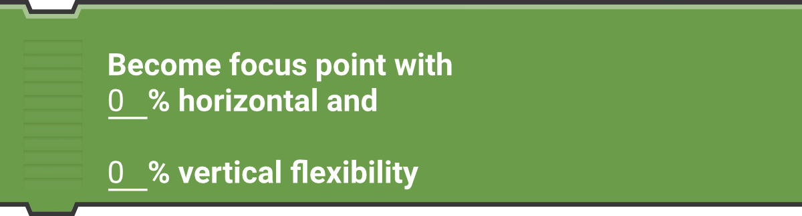

આ કોડ બ્લોક અભિનેતાને સ્ક્રીનના ફોકસ પોઇન્ટ તરીકે સેટ કરે છે, જેમાં હોરિઝોન્ટલ અને વર્ટિકલ દિશામાં ચોક્કસ લવચીકતા હોય છે. તે કેમેરાને એક પાત્રનું અનુસરણ કરવા માટે કહેવાની જેમ છે જ્યારે કેન્દ્રની આસપાસ કેટલાક ચળવળને મંજૂરી આપે છે.
