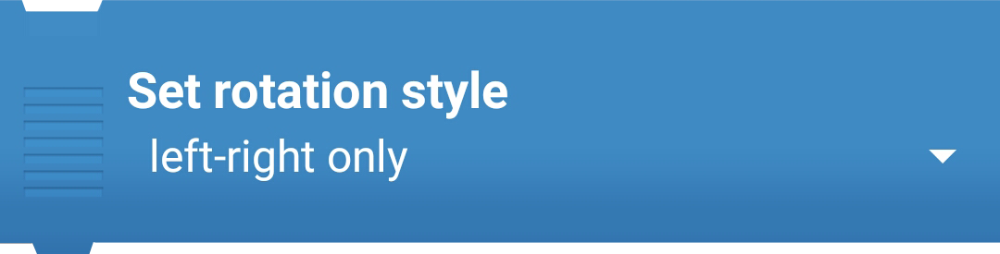

પદાર્થ કેવી રીતે ફેરવે છે તે બદલાય છે (સૌ-પરિભરી, માત્ર ડાબેથી જમણે, અથવા ફેરવશો નહીં). તે નક્કી કરવા જેવું છે કે શું તમારો પાત્ર સંપૂર્ણ રીતે ફેરવી શકે છે, ફક્ત ડાબે અને જમણે ફર્સ્ટ કરી શકે છે, અથવા તે ક્યારેય પણ ફેરવશે નહીં.
