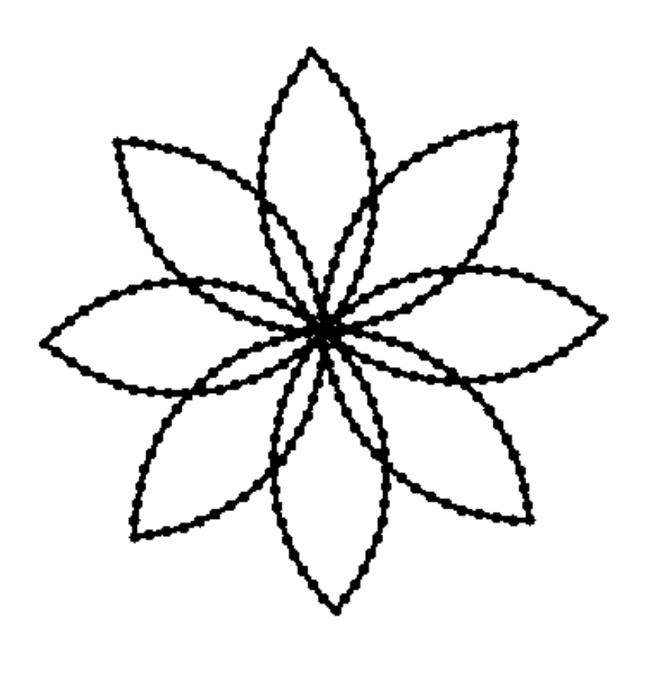

במדריך הזה תלמדו איך לרקום לוטוס (64.8 x 64.8 מ״מ).

כדאי לדעת כבר מה זו לולאה ואיך היא עובדת.

אם עוד לא רקמתם שום דבר, כדאי להציץ במדריכי הרקמה מסדרת [המתחילים](../embroidery-tutorials-beginner/index.md).

לעוד מידע או להצעות לעיצובים, כדאי להציץ במדריכים האחרים.

*כאן אפשר להוריד את המדריך בפורמט PDF*:

[לוטוס](../../../media/embroidery-tutorials/Lotus.pdf)

### 1. צרו דמות רקמה חדשה (ראו [יצירת דמויות רקמה](../embroidery-tutorials-beginner/create-embroidery-objects.md)) והכניסו את התסריטים הבאים:

### 2. המבנה הבסיסי

### 3. עלי כותרת

החלק הזה נקרא בכל פעם שנשלחת ההודעה „עלה כותרת”. הוסיפו אותו גם לתסריט שלכם.

### 4. הקישו על ההפעלה כדי להתחיל את העיצוב שלכם!
