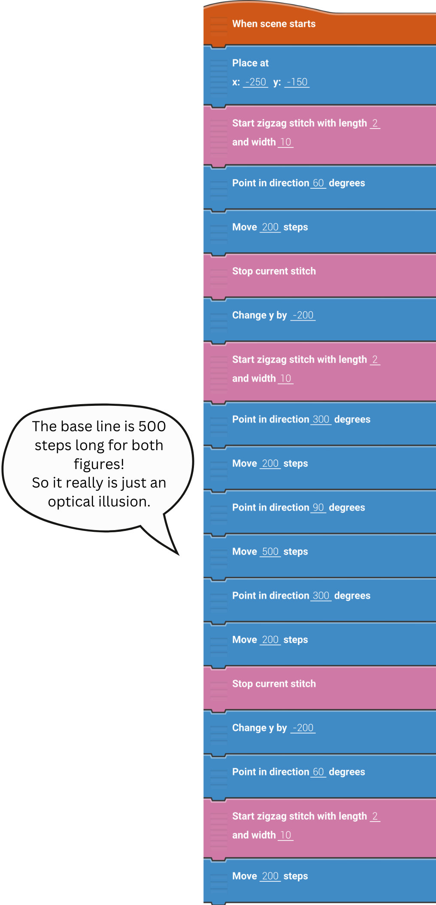

במדריך הזה תלמדו איך לרקום אשליה אופטית (101.8 x 170.2 מ״מ).

אם עוד לא רקמתם שום דבר, כדאי להציץ במדריכי הרקמה מסדרת [המתחילים](../embroidery-tutorials-beginner/index.md).

לעוד מידע או להצעות לעיצובים, כדאי להציץ במדריכים האחרים.

*כאן אפשר להוריד את המדריך בפורמט PDF*:

[אשליה אופטית](../../../media/embroidery-tutorials/Optical-Illusion.pdf)

### 1. צרו דמות רקמה חדשה (ראו [יצירת דמויות רקמה](../embroidery-tutorials-beginner/create-embroidery-objects.md)) והכניסו את התסריטים הבאים:

### 2. הדמות הראשונה:

### 3. הדמות השנייה

### 4. הקישו על ההפעלה כדי להתחיל את העיצוב שלכם!
