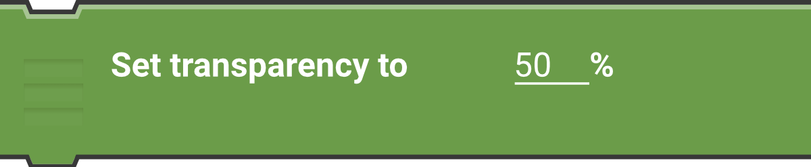

אפשר להוסיף רקע לפרויקט שלכם ב־Catrobat.

אפשר להשתמש ברקעים בדרכים שונות. ב־Pocket Code אפשר להשתמש בהם כדי לשפר את **המשחקים** מבחינה חזותית, לספר **סיפורים**, או לתת לדמויות ולאובייקטים שלכם הקשר נוסף.

במכשירים של מעבדת יצירה, כמו **מכונות חיתוך** או **מכונות רקמה**, הרקעים משמשים כתבניות עיצוב, למשל לחיתוכים או לדפוסי רקמה.

\
כדי להוסיף רקע, הקישו על „רקע” בתצוגת הפרויקט.\
[פתיחת תמונה](../../../media/getting-started/grafik-16.png)

ב**אזור התסריט (2)** אפשר לתכנת את הרקע שלכם – אבל לא כל הבלוקים זמינים לכך. שני הבלוקים הבאים חשובים במיוחד:  ו־

ב**אזור המראות (1)** מוסיפים רקע.

\
לשם כך הקישו על סמל ה־+.\
[פתיחת תמונה](../../../media/getting-started/grafik-14.png)

אפשר להעלות תמונות משלכם, להשתמש ברקעים מוכנים, או ליצור רקע בעצמכם.

**ציור**: אפשר ליצור רקע משלכם עם **Pocket Paint**. Pocket Paint היא תוכנת ציור ([מידע נוסף על Pocket Paint](https://catrobat.org/pocket-paint/))

**מראות**: בחרו אחד מתוך אוסף של רקעים מוכנים ([מידע נוסף על הספרייה למדיה](../elements/medialibrary.md)).

**גלריה**: אפשר לבחור תמונה מהגלריה בסמארטפון שלכם.

**מצלמה**: אפשר להשתמש במצלמה של המכשיר כדי לצלם תמונה ולהוסיף אותה כרקע.

\
לחצו על חץ החזרה שבפינה הימנית העליונה כדי לחזור ל**תצוגת הפרויקט**.\
[פתיחת תמונה](../../../media/getting-started/grafik-17.png)

הוספתם עכשיו רקע.
