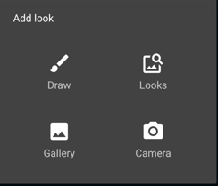

तुम Catrobat में अपने प्रोजेक्ट में पृष्ठभूमि जोड़ सकते हो।

पृष्ठभूमियों का कई तरह से इस्तेमाल हो सकता है। Pocket Code में उनसे **गेम** को सजाया जा सकता है, **कहानियाँ** सुनाई जा सकती हैं, या तुम्हारे पात्रों और ऑब्जेक्ट को ज़्यादा संदर्भ दिया जा सकता है।

**प्लॉटर** या **कढ़ाई मशीन** जैसे मेकरस्पेस उपकरणों के लिए पृष्ठभूमियाँ डिज़ाइन टेम्पलेट का काम करती हैं, जैसे कटिंग या कढ़ाई के पैटर्न के लिए।

पृष्ठभूमि जोड़ने के लिए प्रोजेक्ट व्यू में "पृष्ठभूमि" पर टैप करो।

**स्क्रिप्ट वाले हिस्से (2)** में तुम अपनी पृष्ठभूमि को प्रोग्राम कर सकते हो, लेकिन सारे ब्लॉक यहाँ उपलब्ध नहीं होते। ये दो ब्लॉक खास तौर पर ज़रूरी हैं:  और 

**रूप वाले हिस्से (1)** में तुम पृष्ठभूमि जोड़ते हो। ऐसा करने के लिए + चिह्न पर टैप करो।

तुम अपनी खुद की चित्र अपलोड कर सकते हो, बने-बनाए पृष्ठभूमि इस्तेमाल कर सकते हो, या खुद पृष्ठभूमि बना सकते हो।

**बनाएँ**: **Pocket Paint** से अपनी खुद की पृष्ठभूमि बनाओ। Pocket Paint एक ड्रॉइंग प्रोग्राम है ([Pocket Paint के बारे में ज़्यादा](https://catrobat.org/docs/pocket-paint/))

**रूप**: पहले से बनी पृष्ठभूमियों के संग्रह में से कोई चुनो ([मीडिया लाइब्रेरी के बारे में ज़्यादा](../elements/medialibrary.md)).

**गैलरी**: अपने स्मार्टफ़ोन की गैलरी से कोई चित्र चुन सकते हो।

**कैमरा**: अपने डिवाइस के कैमरे से फ़ोटो लेकर उसे पृष्ठभूमि के रूप में जोड़ सकते हो।

अब तुमने पृष्ठभूमि जोड़ दी है। **प्रोजेक्ट व्यू** पर वापस जाने के लिए ऊपर दाएँ कोने में बैक तीर पर टैप करो।
