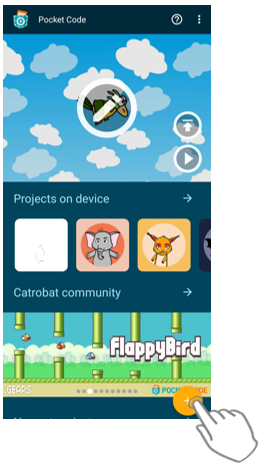

ऐप को अपने स्मार्टफ़ोन या टैबलेट पर खोलो।

\
नया प्रोजेक्ट बनाने के लिए + चिह्न पर टैप करो।\
[चित्र खोलो](../../../media/getting-started/MainScreen_NewProject.png)

प्रोजेक्ट को एक नाम दो (1) और तय करो कि तुम्हारा गेम पोर्ट्रेट (खड़ा) फ़ॉर्मैट में हो या लैंडस्केप (आड़ा) में (2)।

\
फिर चेकमार्क (3) से पक्का करो।\
[चित्र खोलो](../../../media/getting-started/NewProject.png)

अब तुम अपने प्रोजेक्ट व्यू में हो। सबसे ऊपर तुम्हें अपने गेम का नाम दिखता है।

नीचे तुम **पृष्ठभूमि** देखते हो। अभी पृष्ठभूमि खाली है। अगर उसे बदलना चाहते हो, तो उस पर टैप करो।

पृष्ठभूमि के नीचे तुम्हें **पात्रों और ऑब्जेक्ट** का हिस्सा दिखता है, जहाँ तुम्हारे गेम में जोड़े गए पात्र आएँगे। अभी यह हिस्सा भी खाली है।

नीचे दाएँ कोने में तुम्हें दो ज़रूरी बटन दिखते हैं:

\
**चलाएँ** बटन से तुम अपना गेम शुरू करते हो।

\
**प्लस** बटन से तुम अपने गेम में नया पात्र या ऑब्जेक्ट जोड़ते हो।

\
अब तुम अपने प्रोजेक्ट व्यू में हो।\
[चित्र खोलो](../../../media/getting-started/ProjectScreen-1-e1732694778782.jpg)
