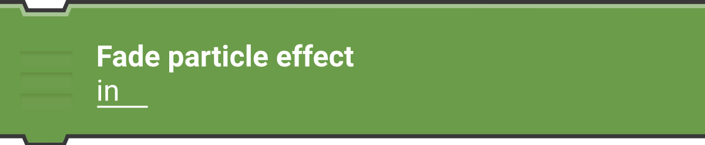

यह ब्लॉक तुम्हारे पात्र में कण (पार्टिकल) जोड़ता है और समय के साथ उन्हें धीरे-धीरे गायब कर देता है। इसे, उदाहरण के लिए, आतिशबाज़ी दिखाने, धुआँ जोड़ने या तुम्हारे किरदार को तेज़ी से प्रकट करने के लिए इस्तेमाल करो।
