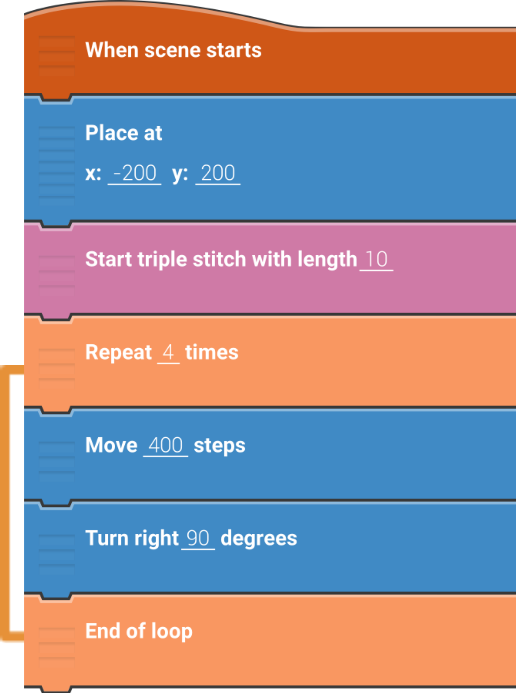

U ovom vodiču naučit ćeš kako izvesti Creepera iz Minecrafta (80 x 80 mm).

Trebaš već znati što je petlja i kako ona radi.

Vodič **[Kvadrat](../embroidery-tutorials-beginner/square.md)** može ti pomoći u ovom vodiču.

Pogledaj vodiče za vezenje iz serije [Za početnike](../embroidery-tutorials-beginner/index.md) ako još nisi ništa izvezao.

Za više informacija ili prijedloge dizajna pogledaj ostale vodiče.

*Ovdje možeš preuzeti vodič u PDF formatu*:

[Creeper-Minecraft-en](../../../media/embroidery-tutorials/Creeper-Minecraft-en.pdf)

### 1. Stvori novi objekt za vezenje (pogledaj [Stvaranje objekata za vezenje](../embroidery-tutorials-beginner/create-embroidery-objects.md)) i umetni sljedeće skripte:

### 2. Lice

### 3. Obris

### 4. Dodirni play da pokreneš svoj dizajn!
