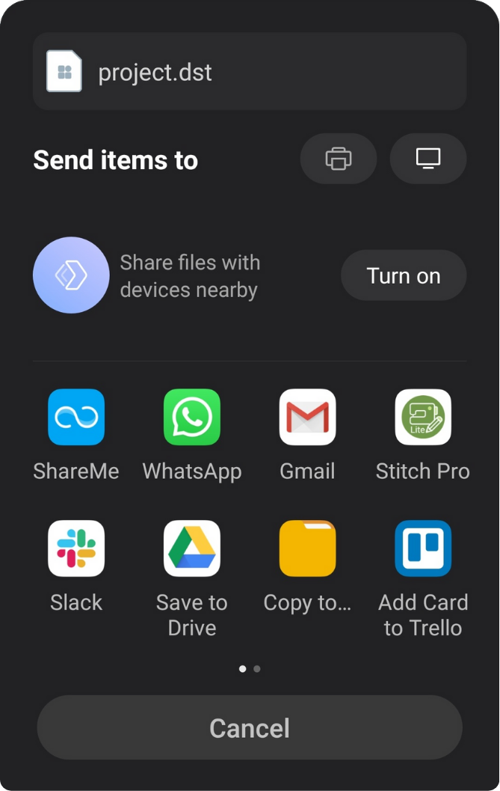

Dalam tutorial ini, kamu akan belajar cara menyimpan dan membagikan desain jadimu di perangkat seluler.

Untuk ini, kamu butuh desain bordir yang sudah jadi dan ingin kamu ekspor. Kalau kamu belum punya, silakan cari inspirasi di [tutorial bordir](index.md) kami!

*Di sini kamu bisa mengunduh tutorial dalam format PDF*:

[Ekspor Desain](../../../media/embroidery-tutorials/Export-Designs.pdf)

### 1. Mulai proyekmu dan tunggu sampai terbuka sepenuhnya. Kalau tidak, polanya akan tidak lengkap.

### 2. Ketuk kembali dan tekan tombol bagikan.

### 3. Bagikan file bordirmu lewat e-mail atau simpan ke ponselmu.

Fungsi berbagi mungkin terlihat sedikit berbeda di setiap ponsel.

Desain bordirmu akan disimpan sebagai file DST.

Mesin bordir mengenal format file ini dan akan menyelesaikan desainmu di kainmu.
