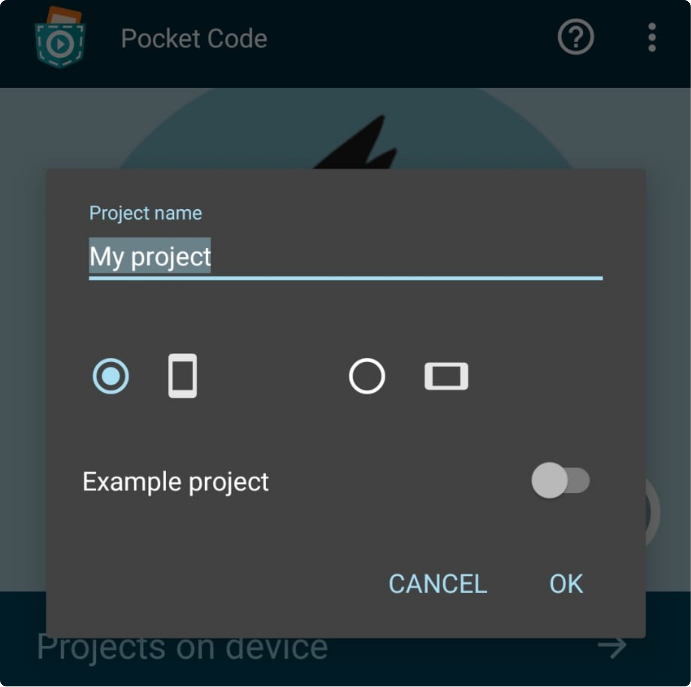

Dalam tutorial ini, kamu akan belajar semua yang perlu kamu ketahui tentang Pocket Code untuk mulai membuat proyek pertamamu. Kami akan memandu langkah demi langkah cara mengunduh aplikasi, membukanya, dan membuat proyek baru.

\
Kami akan memandu langkah demi langkah cara mengunduh aplikasi, membukanya, dan membuat proyek baru.\
[Buka gambar](../../../media/game-tutorials/New-Program.png)

Ini adalah tutorial pertama, dan kamu tidak perlu pengetahuan apa pun sebelumnya.

Jadi, tunggu apa lagi? Ambil ponselmu dan mulai sekarang!

*Di sini kamu bisa mengunduh tutorial dalam format PDF:*

[Buka PDF](../../../media/game-tutorials/New-Program.pdf)

### 1. Instal Pocket Code

Pertama, kamu perlu memasang aplikasi Pocket Code di perangkatmu. Untuk langkah ini, kamu perlu Akun Google. Sekarang perangkatmu akan mengunduh dan memasang aplikasi. Langkah ini bisa memakan waktu, tergantung koneksi internetmu.

\
Kamu bisa menemukan aplikasi dengan mencari “Pocket Code” di Google Play Store dan mengunduhnya dengan mengetuk “instal”.\
[Buka gambar](../../../media/game-tutorials/New-Program-2.png)

Setelah Pocket Code berhasil diunduh dan dipasang, kamu bisa menemukan aplikasinya di laci aplikasi atau di layar utama, tergantung perangkatmu. Kamu bisa memindahkan aplikasi ke mana saja sesuka hatimu.

### 2. Buka aplikasi

\
Saat kamu membuka aplikasi, kamu melihat berbagai kategori.\
[Buka gambar](../../../media/game-tutorials/New-Program-1.png)

### 3. Buat proyek baru

Langkah berikutnya adalah benar-benar membuat proyek baru. Sekarang kamu harus memasukkan nama proyek dan memilih apakah proyekmu akan berformat lanskap atau tidak. Dengan menekan “OK”, proyek akan dibuat.

\
Caranya, tekan tombol plus kuning di pojok kanan bawah.\
[Buka gambar](../../../media/game-tutorials/New-Program.png)

### 4. Berhasil! Kamu sudah membuat proyek barumu sendiri.

Sekarang kamu sudah memasang Pocket Code dan tahu cara membuat proyek baru. Sekarang kamu bisa mulai memprogram!

Untuk itu, kamu perlu tahu cara membuat objek baru di proyek. Lihat tutorial **[Objek Baru](new-object.md)**, yang menjelaskan semuanya langkah demi langkah.
