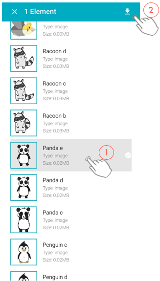

Pustaka media Catrobat adalah kumpulan **aktor**, **latar belakang**, suara, dan objek yang bisa kamu pakai di proyekmu. Kamu bisa mengubah semuanya sesuai idemu!

[Aktor](#tambahkan-aktor-baru-dari-pustaka-media)

[Latar belakang](#tambahkan-latar-belakang-dari-pustaka-media)

[Suara](#tambahkan-suara-dari-pustaka-media)

[Objek](#tambahkan-objek-dari-pustaka-media)

***

### Tambahkan aktor baru dari pustaka media

Di tampilan proyek, ketuk simbol + ([info lebih lanjut](../quick-start-guide/add-actors-and-objects.md)) untuk menambahkan aktor atau objek baru. Pilih “Tampilan”.

Pilih aktor yang ingin kamu pakai di programmu. Ketuk aktor (1) dan unduh (2).

Sekarang kamu bisa memberi aktor itu nama baru (1) dan menempatkannya di gamemu (2). Artinya, kamu bisa menggeser aktor langsung di layar. Kamu akan langsung melihat posisinya di proyek. Konfirmasi dengan “OK”.

Tempatkan aktormu (1) dan konfirmasi dengan tanda centang (2).

***

### Tambahkan latar belakang dari pustaka media

Buka latar belakang di tampilan proyek. Pindah ke bagian tampilan dan tambahkan tampilan baru ([info lebih lanjut](../quick-start-guide/add-background.md)). Ketuk “Tampilan.”

Pilih latar belakang yang cocok untuk programmu. Ketuk latar belakang (1) dan unduh (2).

***

### Tambahkan suara dari pustaka media

Suara bisa ditambahkan ke latar belakang maupun ke aktor atau objekmu. Ketuk aktor atau latar belakang tempat kamu ingin menambahkan suara. Buka tampilan suara dan ketuk simbol +.

Ketuk “Suara” untuk membuka pustaka media.

Pilih suara yang cocok untuk programmu. Ketuk suara (1) dan unduh (2).

***

### Tambahkan objek dari pustaka media

Catrobat memberimu kemungkinan mengunduh objek yang sudah jadi. Objek adalah elemen game yang berdiri sendiri, misalnya hitung mundur, yang sudah punya skrip.

Kamu menambahkan objek mirip seperti aktor.

Di tampilan proyek, ketuk simbol + ([info lebih lanjut](../quick-start-guide/add-actors-and-objects.md)) untuk menambahkan objek baru.

Pilih “Pustaka.”

Cari objek yang ingin kamu pakai di programmu. Ketuk objek (1) dan unduh (2).

Sekarang kamu bisa memberi objek itu nama baru (1) dan menempatkannya di gamemu (2). Artinya, kamu bisa menggeser objek langsung di layar. Kamu akan langsung melihat posisinya di proyek. Konfirmasi dengan “OK.”

Tempatkan objekmu (1) dan konfirmasi dengan tanda centang (2).
