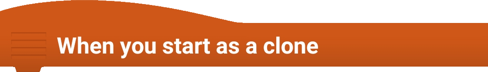

Mengarahkan klon yang dibuat dari sebuah objek dengan instruksi untuk melakukan aksi yang diinginkan. Proses ini memungkinkan meniru fungsi objek asli, sambil mengendalikan klon secara terpisah. Berbagai perilaku atau properti klon bisa ditentukan sesuai kebutuhan.
