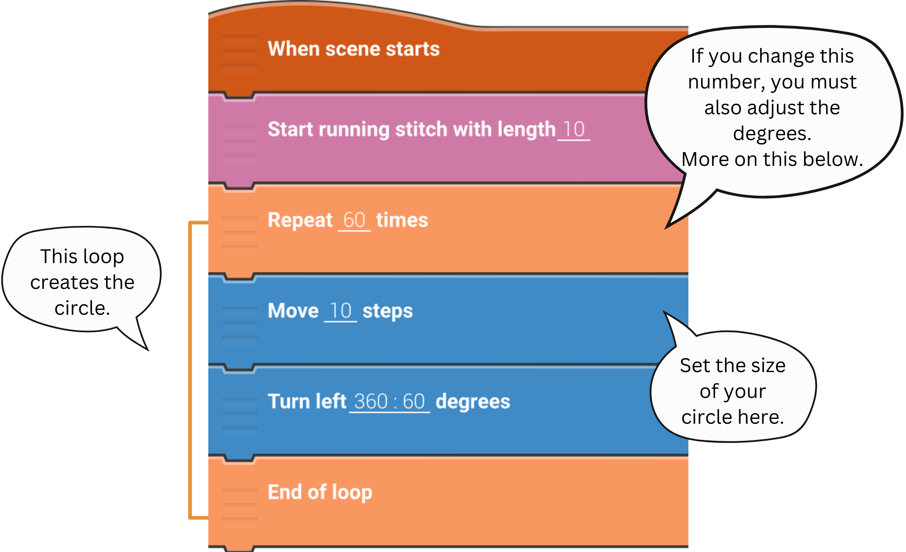

In questo tutorial impari a ricamare un cerchio (76.2 x 76.2mm).

Dovresti già sapere come creare un nuovo oggetto e come aggiungere dei blocchi. Se ti serve ancora aiuto, guarda i tutorial della [serie Per iniziare](../../game-tutorials/starter-tutorials/index.md). Inoltre, i blocchi per il ricamo devono essere già attivati. Come fare lo scopri nel tutorial **[Attivare i blocchi per il ricamo](activate-embroidery-bricks.md)**.

Per altre informazioni o idee per i disegni, guarda gli altri tutorial.

*Qui puoi scaricare il tutorial in formato PDF*:

[Cerchio](../../../media/embroidery-tutorials/Circle.pdf)

### 1. Crea un nuovo oggetto da ricamo (vedi [Creare oggetti da ricamo](create-embroidery-objects.md)).

### 2. Ora inizia e aggiungi i blocchi al tuo script, uno dopo l’altro.

### 3. Tocca play per avviare il tuo disegno!

Devi indicare di quanti gradi girare, qui 360 ÷ 60.

Per un cerchio il 360 resta sempre uguale! Quindi devi scegliere bene il numero di ripetizioni, come qui 60. **Prova altre combinazioni!** Per esempio: 30 e 360 ÷ 30 oppure 120 e 360 ÷ 120.
