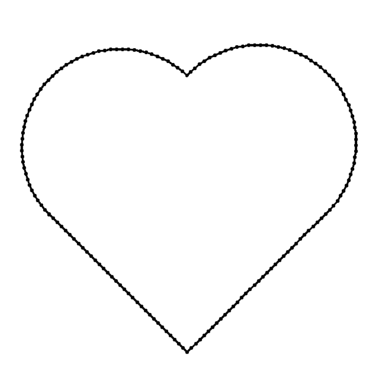

In questo tutorial impari a ricamare un cuore (103.6 x 112.8mm).

Dovresti già sapere cos’è un ciclo e come funziona.

Per questo tutorial ti può aiutare il tutorial **[Semicerchio](../embroidery-tutorials-beginner/semicircle.md)**.

Se non hai ancora ricamato niente, guarda i tutorial di ricamo della serie [Principianti](../embroidery-tutorials-beginner/index.md).

Per altre informazioni o idee per i disegni, guarda gli altri tutorial.

*Qui puoi scaricare il tutorial in formato PDF*:

[Cuore](../../../media/embroidery-tutorials/Heart.pdf)

### 1. Crea un nuovo oggetto da ricamo (vedi [Creare oggetti da ricamo](../embroidery-tutorials-beginner/create-embroidery-objects.md)) e aggiungi questi script:

### 2. Struttura di base

### 3. Semicerchi

Questa parte viene eseguita ogni volta che viene inviato il messaggio semicerchio. Aggiungi anche questa al tuo script.

### 4. Tocca play per avviare il tuo disegno!
