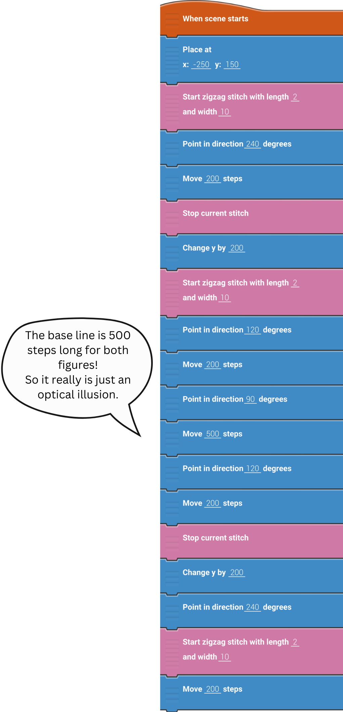

In questo tutorial impari a ricamare un’illusione ottica (101.8 x 170.2mm).

Se non hai ancora ricamato niente, guarda i tutorial di ricamo della serie [Principianti](../embroidery-tutorials-beginner/index.md).

Per altre informazioni o idee per i disegni, guarda gli altri tutorial.

*Qui puoi scaricare il tutorial in formato PDF*:

[Illusione ottica](../../../media/embroidery-tutorials/Optical-Illusion.pdf)

### 1. Crea un nuovo oggetto da ricamo (vedi [Creare oggetti da ricamo](../embroidery-tutorials-beginner/create-embroidery-objects.md)) e aggiungi questi script:

### 2. Prima figura:

### 3. Seconda figura

### 4. Tocca play per avviare il tuo disegno!
