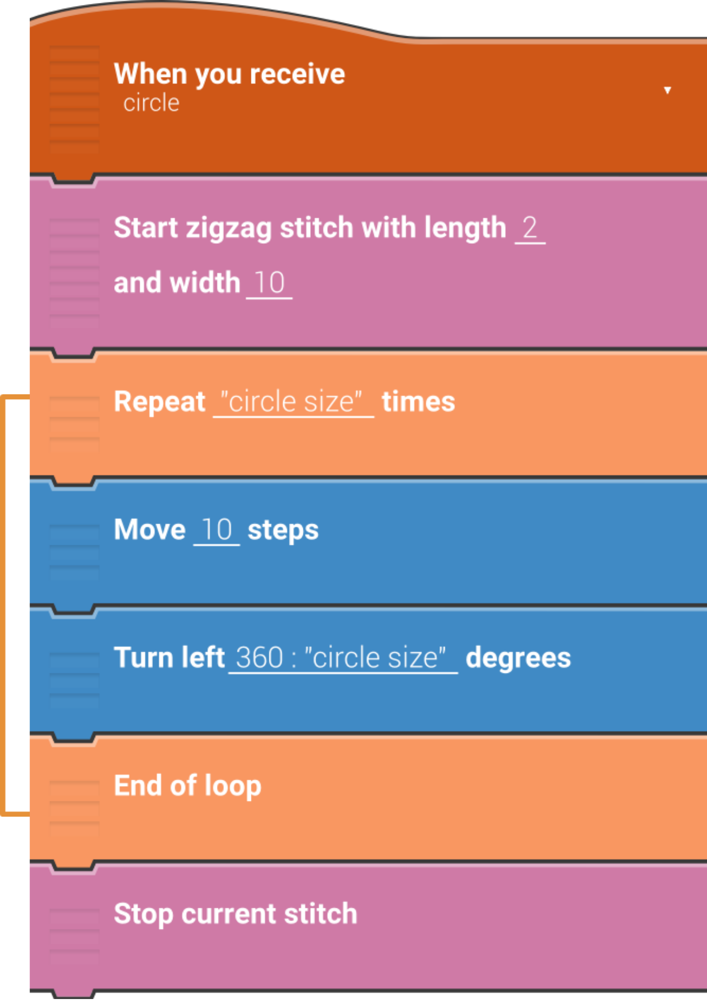

In questo tutorial impari a ricamare un lecca-lecca (124.6 x 65.6mm).

Dovresti già sapere cos’è un ciclo e come funziona.

Per questo tutorial ti può aiutare il tutorial **[Cerchio](../embroidery-tutorials-beginner/circle.md)**.

Se non hai ancora ricamato niente, guarda i tutorial di ricamo della serie [Principianti](../embroidery-tutorials-beginner/index.md).

Per altre informazioni o idee per i disegni, guarda gli altri tutorial.

*Qui puoi scaricare il tutorial in formato PDF*:

[LollipopPro](../../../media/embroidery-tutorials/LollipopPro.pdf)

### 1. Crea un nuovo oggetto da ricamo (vedi [Creare oggetti da ricamo](../embroidery-tutorials-beginner/create-embroidery-objects.md)) e aggiungi questi script:

### 2. Struttura di base

### 3. Cerchi

Questa parte viene eseguita ogni volta che viene inviato il messaggio cerchio. Aggiungi anche questa al tuo script.

### 4. Tocca play per avviare il tuo disegno!
