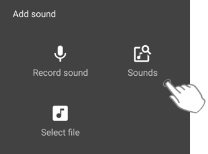
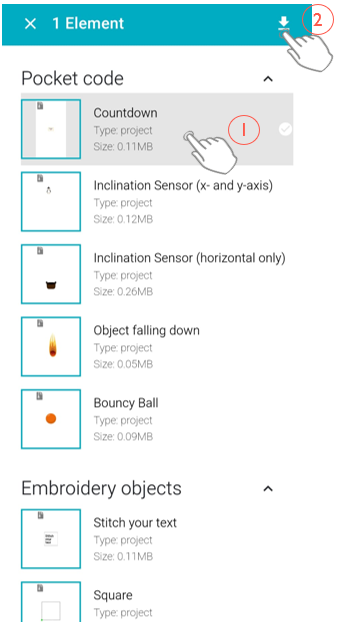

La libreria multimediale di Catrobat è una raccolta di **attori**, **sfondi**, suoni e oggetti che puoi usare nei tuoi progetti. Puoi cambiare tutto come vuoi, secondo le tue idee!

[Attore](#aggiungi-un-nuovo-attore-dalla-libreria-multimediale)

[Sfondo](#aggiungi-uno-sfondo-dalla-libreria-multimediale)

[Suono](#aggiungi-un-suono-dalla-libreria-multimediale)

[Oggetto](#aggiungi-un-oggetto-dalla-libreria-multimediale)

***

### Aggiungi un nuovo attore dalla libreria multimediale

Nella vista del progetto, tocca il simbolo + [(altre informazioni](../quick-start-guide/add-actors-and-objects.md)) per aggiungere un nuovo attore o oggetto.

\
Scegli "Aspetti".\
[Apri l’immagine](../../../media/getting-started/NewActor-e1732794461668.jpg)

Scegli un attore che vuoi usare nel tuo programma.

\
Tocca l'attore (1) e scaricalo (2).\
[Apri l’immagine](../../../media/getting-started/grafik-19.png)

Ora puoi dare un nuovo nome all'attore (1) e metterlo al suo posto nel tuo gioco guardando lo schermo (2). Questo vuol dire che puoi spostare l'attore direttamente sullo schermo. Vedi subito dove si trova nel progetto.

\
Conferma con "OK".\
[Apri l’immagine](../../../media/getting-started/grafik-29.png)

\
Metti l'attore al suo posto (1) e conferma con il segno di spunta (2).\
[Apri l’immagine](../../../media/getting-started/grafik-21.png)

***

### Aggiungi uno sfondo dalla libreria multimediale

Nella vista del progetto, vai allo sfondo. Passa alla parte degli aspetti e aggiungi un nuovo aspetto ([altre informazioni](../quick-start-guide/add-background.md)). Tocca "Aspetti".

Scegli uno sfondo adatto che vuoi usare nel tuo programma.

\
Tocca lo sfondo (1) e scaricalo (2).\
[Apri l’immagine](../../../media/getting-started/grafik-22.png)

***

### Aggiungi un suono dalla libreria multimediale

Puoi aggiungere i suoni sia allo sfondo sia agli attori o agli oggetti. Tocca l'attore o lo sfondo a cui vuoi aggiungere il suono.

\
Vai alla vista dei suoni e tocca il simbolo +.\
[Apri l’immagine](../../../media/getting-started/grafik-23.png)

\
Tocca "Suoni" per aprire la libreria multimediale.\
[Apri l’immagine](../../../media/getting-started/grafik-30.png)

Scegli un suono adatto che vuoi usare nel tuo programma.

\
Tocca il suono (1) e scaricalo (2).\
[Apri l’immagine](../../../media/getting-started/grafik-25.png)

***

### Aggiungi un oggetto dalla libreria multimediale

Catrobat ti permette di scaricare oggetti già pronti. Gli oggetti sono singoli pezzi di un gioco, per esempio un conto alla rovescia, che hanno già uno script.

Aggiungi gli oggetti più o meno come gli attori.

Nella vista del progetto, tocca il simbolo + ([altre informazioni](../quick-start-guide/add-actors-and-objects.md)) per aggiungere un nuovo oggetto.

\
Scegli "Libreria".\
[Apri l’immagine](../../../media/getting-started/NewActor-e1732794461668.jpg)

Cerca un oggetto che vuoi usare nel tuo programma.

\
Tocca l'oggetto (1) e scaricalo (2).\
[Apri l’immagine](../../../media/getting-started/grafik-27.png)

Ora puoi dare un nuovo nome all'oggetto (1) e metterlo al suo posto nel tuo gioco guardando lo schermo (2). Questo vuol dire che puoi spostare l'oggetto direttamente sullo schermo. Vedi subito dove si trova nel progetto.

\
Conferma con "OK".\
[Apri l’immagine](../../../media/getting-started/grafik-29.png)

Metti l'oggetto al suo posto (1) e conferma con il segno di spunta (2).
