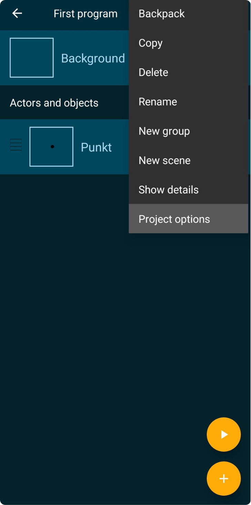

このチュートリアルでは、作ったプロジェクトを、友だちや Catrobat コミュニティ全体と共有する方法を学びます。

\
このチュートリアルでは、作ったプロジェクトを、友だちや Catrobat コミュニティ全体と共有する方法を学びます。\
[画像を開く](../../../media/game-tutorials/Upload-and-Share.png)

このチュートリアルでは、共有したい自分のプロジェクトが、すでに必要です。プロジェクトの作り方がまだわからないときは、**[新しいプロジェクト](new-project.md)**のチュートリアルで、使い方を学べます。

*このチュートリアルは、PDF 形式でダウンロードできます:*

[PDFを開く](../../../media/game-tutorials/Upload-and-Share.pdf)

### 1. プロジェクトのオプション

プロジェクトをアップロードしたり、共有したりしたいときは、プロジェクトを開いて、右上の3つの点をタップします。

\
そして「プロジェクトオプション」をタップします。\
[画像を開く](../../../media/game-tutorials/Upload-and-Share.png)

### 2. プロジェクトのオプション

これで、名前を変えたり、説明を追加したり、いろいろな設定をしたりできます。

また、「プログラムをアップロード」と「プロジェクトをエクスポート」という2つの選択肢があります。

\
どちらも、次のステップで説明します。\
[画像を開く](../../../media/game-tutorials/Upload-and-Share-1.png)

### 3. プログラムをアップロードする

プロジェクトを Catrobat Share にアップロードして、コミュニティ全体が見られるようにしたいときは、*プログラムをアップロード*を選びます。

### 4. プログラムをアップロードする

プロジェクトを Share にアップロードするためのボタンをタップすると、まだアカウントを作っていない場合は、アカウントを作る必要があります。または、Google でサインインできます。サインインしたら、プロジェクトに名前を付けて、説明を書きます。そして、プログラムにいちばん合う、カテゴリーを3つまで選びます。

\
それから「次へ」をタップして、プログラムをアップロードします。\
[画像を開く](../../../media/game-tutorials/Upload-and-Share-2.png)

### 5. プロジェクトをエクスポートする

プロジェクトを友だちと共有したいときは、*プロジェクトをエクスポート*を選びます。

### 6. プロジェクトをエクスポートする

このボタンで、.catrobat ファイルを保存できます。 このファイルは、友だちと個別に共有できます。

\
機器のファイルの管理アプリで保存して、そのように共有できます。\
[画像を開く](../../../media/game-tutorials/Upload-and-Share-3.png)

できました！ 最初のプログラムを共有できました！

次のプロジェクトのヒントやアイデアがほしいときは、いろいろなレベル（初級、中級、上級）のチュートリアルを見てください。
