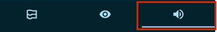

Catrobat медиа кітапханасы - бұл жобаларыңызда пайдалана алатын **актерлер**, **ортасы**, дыбыстар мен нысандардың жинағы. Сен өзіңіздің идеяларыңызға сәйкес келетінін жасай аласың!

[Актер](#медиа-кітапханасынан-жаңа-актерді-қосу)

[Тақырыбы](#медиа-кітапханасынан-фоновой-жазуды-қосу)

[Дыбыс](#медиа-кітапханасынан-дыбыс-қосу)

[Нысан](#медиа-кітапханасынан-нысанды-қосу)

***

### Медиа кітапханасынан жаңа актерді қосу

Жоба көрінісінде жаңа актер немесе объект қосу үшін + символын [(Қосымша ақпарат)](../quick-start-guide/add-actors-and-objects.md) бас. «Суреттер» таңда.

Бағдарламаңызда қолданғыңыз келетін актерді таңда. Актер (1) -ге бас және оны жүктеңіз (2).

Енді сен актерге жаңа аты бере аласың (1) және оны ойынға бейнелі түрде орналастыра аласың (2). Бұл актердің экранға тікелей көтерілуі мүмкін дегенді білдіреді. Жобаның қай жерінде орналасқанын дереу көресің. «Жарайды» дегенді растаңыз.

Актеріңізді (1) қойыңыз және (2) белгісімен растаңыз.

***

### Медиа кітапханасынан фоновой жазуды қосу

Жоба көрінісіндегі фонға өту. Көрініс бөліміне ауысып, жаңа көрініс ([қосымша ақпарат](../quick-start-guide/add-background.md)) қосыңыз. «Суреттер» дегенді бас.

Бағдарламада қолданғыңыз келетін орынды тақырыпты таңда. Басуды (1) басып, жүктеңіз (2).

***

### Медиа кітапханасынан дыбыс қосу

Тақырыбыңыз бен актерлеріңізге немесе нысандарыңызға да дыбыстар қосылуы мүмкін. Әнді қосу үшін актеріңізге немесе фонуға бас. Дыбыс көрінісіне кіріп, + символын бас.

Медиа кітапханасына кіру үшін «Дыбыстар» батырмасын бас.

Бағдарламаңызда қолдануға болатын қолайлы дыбысты таңда. Дыбысты (1) басу және оны жүктеу (2).

***

### Медиа кітапханасынан нысанды қосу

Catrobat саған дайын нысандарды жүктеу мүмкіндігін ұсынады. Объекттер - бұл сценарийді қамтитын кері есеп сияқты жеке ойын элементтері.

Сен актерлерге ұқсас нысандарды қосасыз.

Жоба көрінісінде жаңа нысанды қосу үшін + символын түртіңіз ([қосымша ақпарат](../quick-start-guide/add-actors-and-objects.md)).

«Кітапхана» таңда.

Бағдарламаңызда қолданғыңыз келетін нысанды іздеңіз. Нысанға (1) батырма қойып, оны жүктеңіз (2).

Енді сен нысанға жаңа атау (1) бере аласың және оны ойынға бейнелі түрде орналастыра аласың (2). Бұл нәрсені тікелей экранға жылжыта алатыныңды білдіреді. Жобаның қай жағында екенін бірден көре аласың. «Жарайды» дегенді растаңыз.

Нысанды (1) қойыңыз және (2) белгісімен растаңыз.
