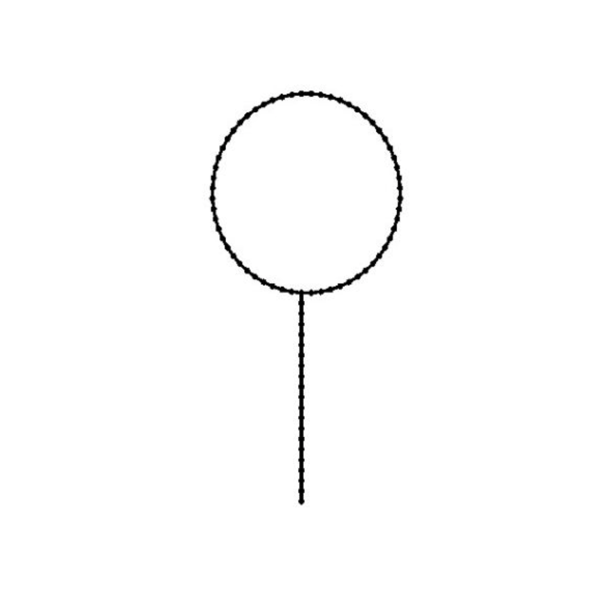

ಈ ಟ್ಯುಟೋರಿಯಲ್ ನಲ್ಲಿ, ನೀನು ಒಂದು ಲೋಲಿಪಾಪ್ (54.7 x 54.8mm) ಅನ್ನು ಹೇಗೆ ಕಸೂತಿ ಮಾಡುವುದು ಎಂಬುದನ್ನು ಕಲಿಯುವಿರಿ.

ನೀನು ಈಗಾಗಲೇ ಹೊಸ ವಸ್ತುವನ್ನು ರಚಿಸಲು ಮತ್ತು ಅಲ್ಲಿ ಕೋಡ್ ಬ್ಲಾಕ್ಗಳನ್ನು ಸೇರಿಸಲು ಹೇಗೆ ತಿಳಿಯಬೇಕು. ನಿನಗೆ ಇನ್ನೂ ಸಹಾಯ ಬೇಕಾದರೆ [ಆರಂಭಿಕ ಸರಣಿ](../../game-tutorials/starter-tutorials/index.md) ನಲ್ಲಿರುವ ಟ್ಯುಟೋರಿಯಲ್ಗಳನ್ನು ಪರಿಶೀಲಿಸಿ. ಇದಲ್ಲದೆ, ಕಸೂತಿ ಕೋಡ್ ಬ್ಲಾಕ್ಗಳನ್ನು ಈಗಾಗಲೇ ಸಕ್ರಿಯಗೊಳಿಸಬೇಕು. ನೀನು ಇದನ್ನು ಹೇಗೆ ಮಾಡಬೇಕೆಂದು **[ಎಂಬ್ರಾಯ್ಡರಿ ಕೋಡ್ ಬ್ಲಾಕ್ಗಳನ್ನು ಸಕ್ರಿಯಗೊಳಿಸಿ](activate-embroidery-bricks.md)** -ಟ್ಯುಟೋರಿಯಲ್ ನಲ್ಲಿ ಕಾಣಬಹುದು.

ಹೆಚ್ಚಿನ ಮಾಹಿತಿಗಾಗಿ ಅಥವಾ ವಿನ್ಯಾಸ ಸಲಹೆಗಳಿಗಾಗಿ ಇತರ ಟ್ಯುಟೋರಿಯಲ್ಗಳನ್ನು ಪರಿಶೀಲಿಸಿ.

*ಇಲ್ಲಿ ನೀನು ಟ್ಯುಟೋರಿಯಲ್ ಡೌನ್ಲೋಡ್ ಮಾಡಬಹುದು PDF-ಫಾರ್ಮ್ಯಾಟ್*:

[ಲಾಲಿಪೊಪ್](../../../media/embroidery-tutorials/Lollipop.pdf)

### 1. ಹೊಸ ಕಸೂತಿ ವಸ್ತುವನ್ನು ರಚಿಸಿ (ನೋಡಿ [ಕಸೂತಿ ವಸ್ತುಗಳನ್ನು ರಚಿಸಿ](create-embroidery-objects.md)).

### 2. ಈಗ ಪ್ರಾರಂಭಿಸಿ ಮತ್ತು ನಿನ್ನ ಸ್ಕ್ರಿಪ್ಟ್ಗೆ ಕೋಡ್ ಬ್ಲಾಕ್ಗಳನ್ನು ಹಂತ ಹಂತವಾಗಿ ಸೇರಿಸಿ.

### 3. ನಿನ್ನ ವಿನ್ಯಾಸವನ್ನು ಪ್ರಾರಂಭಿಸಲು ಆಟದ ಟ್ಯಾಪ್ ಮಾಡಿ!

ವೃತ್ತವನ್ನು ಹೇಗೆ ಕಸೂತಿ ಮಾಡುವುದು ಎಂಬುದರ ಕುರಿತು ಹೆಚ್ಚಿನ ಮಾಹಿತಿಗಾಗಿ **[ವಲಯ](circle.md)** -ನ ಬೋಧನೆಯನ್ನು ನೋಡಿ.
