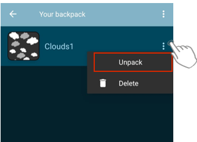

Pocket Code ನಲ್ಲಿನ **ಬ್ಯಾಕ್‌ಪ್ಯಾಕ್** ವೈಶಿಷ್ಟ್ಯವು ನೀನು **ಉಳಿಸಿ ಮತ್ತು ಮರುಬಳಕೆ ಮಾಡಿ** ನಂತಹ ನಟರು (ವಸ್ತುಗಳು), ಸ್ಕ್ರಿಪ್ಟ್ಗಳು, ನೋಟಗಳು ಅಥವಾ ಧ್ವನಿಗಳನ್ನು **ಯೋಜನೆಗಳಾದ್ಯಂತ** ಅನುಮತಿಸುವ ಪ್ರಾಯೋಗಿಕ ಕಾರ್ಯವಾಗಿದೆ. ಇದು ನಿನಗೆ ಸಮಯವನ್ನು ಉಳಿಸಲು ಮತ್ತು ನಿನ್ನ ಯೋಜನೆಗಳನ್ನು ಹೆಚ್ಚು ಪರಿಣಾಮಕಾರಿಯಾಗಲು ಸಹಾಯ ಮಾಡುತ್ತದೆ.

ನಿನ್ನ ಹಿಂದಿನ ಯೋಜನೆಯ ವಿವಿಧ ಅಂಶಗಳನ್ನು ನೀನು ಸಂಗ್ರಹಿಸಬಹುದಾದ ಡಿಜಿಟಲ್ ಶೇಖರಣಾ ಸ್ಥಳದಂತೆ ಬೆನ್ನುಹೊರೆಯು ಇರುತ್ತದೆ. ಒಮ್ಮೆ ನೀನು ಬ್ಯಾಕ್ಪ್ಯಾಕ್ನಲ್ಲಿ ಉಳಿಸಿದ ನಂತರ, ನೀನು ಈ ಅಂಶಗಳನ್ನು ಇತರ ಯೋಜನೆಗಳಲ್ಲಿ ಹಿಂಪಡೆಯಬಹುದು ಮತ್ತು ಸೇರಿಸಬಹುದು.

### ನಟರಿಗೆ (ವಸ್ತುಗಳಿಗೆ) ನಾನು ಬ್ಯಾಕ್ಪ್ಯಾಕ್ ಅನ್ನು ಹೇಗೆ ಬಳಸುತ್ತೇನೆ?

**ಬೆನ್ನುಹೊರೆಯಲ್ಲಿ ಅಂಕಿಅಂಶಗಳನ್ನು ಪ್ಯಾಕ್ ಮಾಡಿ**

ನೀನು ಒಂದು ಚಿತ್ರವನ್ನು ಹಿಂಭಾಗದ ಚೀಲಕ್ಕೆ ಪ್ಯಾಕ್ ಮಾಡಲು ಬಯಸುವ ಯೋಜನೆಯ ಪ್ರಾಜೆಕ್ಟ್ ವೀಕ್ಷಣೆಗೆ ಹೋಗಿ.

ಚಿತ್ರ (ಅದರ ನೋಟ, ಶಬ್ದಗಳು ಮತ್ತು ಪಠ್ಯಗಳು ಸೇರಿದಂತೆ) ಅನ್ನು ಹಿಂಭಾಗದ ಚೀಲಕ್ಕೆ ಪ್ಯಾಕ್ ಮಾಡಲಾಗುತ್ತದೆ.

\
ಸನ್ನಿವೇಶ ಮೆನು ತೆರೆಯಲು ಚಿತ್ರದ ಮುಂದಿನ ಮೂರು ಬಿಂದುಗಳ ಮೇಲೆ ಕ್ಲಿಕ್ ಮಾಡಿ ಮತ್ತು “ಬ್ಯಾಕ್‌ಪ್ಯಾಕ್‌ಗೆ ಸೇರಿಸಿ” ಆಯ್ಕೆಮಾಡು.\
[ಚಿತ್ರವನ್ನು ತೆರೆ](../../../media/getting-started/grafik-7.png)

**ಬೆನ್ನುಹೊರೆಯಿಂದ ಅಂಕಿಅಂಶಗಳನ್ನು ಸೇರಿಸಿ**

ನೀನು ಚಿತ್ರವನ್ನು ಸೇರಿಸಲು ಬಯಸುವ ಯೋಜನೆಯನ್ನು ತೆರೆಯಿರಿ.

ಯೋಜನೆಯ ವೀಕ್ಷಣೆಯಲ್ಲಿ, ಪ್ಲಸ್ ಚಿಹ್ನೆಯನ್ನು ಟ್ಯಾಪ್ ಮಾಡಿ ಮತ್ತು “ಬ್ಯಾಕ್‌ಪ್ಯಾಕ್” ಆಯ್ಕೆಮಾಡು.

ನಿನ್ನ ಹಿಂಭಾಗದ ಚೀಲದಲ್ಲಿ ನೀನು ಉಳಿಸಿದ ಎಲ್ಲಾ ಅಂಕಿಅಂಶಗಳು ಮತ್ತು ವಸ್ತುಗಳನ್ನು ಈಗ ನೀನು ನೋಡುತ್ತೀರಿ.

\
ಮೂರು ಬಿಂದುಗಳ ಮೇಲೆ ಟ್ಯಾಪ್ ಮಾಡಿ ಮತ್ತು “ಹೊರತೆಗೆಯಿರಿ” ಆಯ್ಕೆಮಾಡು.\
[ಚಿತ್ರವನ್ನು ತೆರೆ](../../../media/getting-started/grafik-8-e1732702791199.png)

***

### ನಾನು ಸ್ಕ್ರಿಪ್ಟ್ಗಳಿಗಾಗಿ ಹಿಂಭಾಗದ ಚೀಲವನ್ನು ಹೇಗೆ ಬಳಸುತ್ತೇನೆ?

**ಸ್ಕ್ರಿಪ್ಟ್ಗಳನ್ನು ಹಿಂಭಾಗದ ಚೀಲದಲ್ಲಿ ಇರಿಸಿಃ:**

ಸ್ಕ್ರಿಪ್ಟ್ ಇರುವ ಚಿತ್ರಕ್ಕೆ ಹೋಗಿ. ಸ್ಕ್ರಿಪ್ಟ್ ಸಂಪಾದಕದಲ್ಲಿ ಬಯಸಿದ ಸ್ಕ್ರಿಪ್ಟ್ ಅನ್ನು ಹಿಡಿದುಕೊಳ್ಳಿ.

\
ಸಂದರ್ಭ ಮೆನುವಿನಿಂದ “ಬ್ಯಾಕ್‌ಪ್ಯಾಕ್‌ಗೆ ಸೇರಿಸಿ” ಆಯ್ಕೆಮಾಡು.\
[ಚಿತ್ರವನ್ನು ತೆರೆ](../../../media/getting-started/WhatsApp-Bild-2024-11-27-um-11.09.00_bec028aa.jpg)

\
ಸ್ಕ್ರಿಪ್ಟ್ಗೆ ಒಂದು ಹೆಸರು ನೀಡಿ ಮತ್ತು ಸರಿ ನಲ್ಲಿ ದೃಢೀಕರಿಸಿ.\
[ಚಿತ್ರವನ್ನು ತೆರೆ](../../../media/getting-started/grafik-9.png)

\
ಸ್ಕ್ರಿಪ್ಟ್ ಅನ್ನು ಉಳಿಸಲಾಗಿದೆ ಮತ್ತು ಇತರ ಯೋಜನೆಗಳಲ್ಲಿ ಬಳಸಬಹುದು.\
[ಚಿತ್ರವನ್ನು ತೆರೆ](../../../media/getting-started/grafik-10.png)

**ಬೆನ್ನುಹೊರೆಯಿಂದ ಸ್ಕ್ರಿಪ್ಟ್ಗಳನ್ನು ಸೇರಿಸಿಃ:**

ನೀನು ಚಿತ್ರಕಥೆಯನ್ನು ಸೇರಿಸಲು ಬಯಸುವ ನಟನನ್ನು ಟ್ಯಾಪ್ ಮಾಡು. ನೀನು ಸ್ಕ್ರಿಪ್ಟ್ ಪ್ರದೇಶವನ್ನು ನೋಡುತ್ತೀರಿ.

\
ಸನ್ನಿವೇಶ ಮೆನು ತೆರೆಯಲು ಮೂರು ಬಿಂದುಗಳ ಮೇಲೆ ಟ್ಯಾಪ್ ಮಾಡಿ ಮತ್ತು “ಬ್ಯಾಕ್‌ಪ್ಯಾಕ್” ನಲ್ಲಿ ಟ್ಯಾಪ್ ಮಾಡು.\
[ಚಿತ್ರವನ್ನು ತೆರೆ](../../../media/getting-started/grafik-11.png)

ಈಗ ನಿನ್ನ ಹಿಂಭಾಗದ ಚೀಲದಲ್ಲಿ ಈಗಾಗಲೇ ಇರುವ ಎಲ್ಲಾ ಪಠ್ಯಕ್ರಮಗಳನ್ನು ನೀನು ನೋಡಬಹುದು.

ಸಂದರ್ಭ ಮೆನು ಮೂಲಕ, ನಿನ್ನ ಹಿಂಭಾಗದ ಚೀಲದಲ್ಲಿ ನಿನಗೆ ಇನ್ನು ಮುಂದೆ ಅಗತ್ಯವಿಲ್ಲದ ಸ್ಕ್ರಿಪ್ಟ್ಗಳನ್ನು ನೀನು ಅಳಿಸಬಹುದು.

\
ಬಯಸಿದ ಸ್ಕ್ರಿಪ್ಟ್ನ ಮುಂದಿನ ಮೂರು ಬಿಂದುಗಳ ಮೇಲೆ ಟ್ಯಾಪ್ ಮಾಡಿ ಮತ್ತು ಸಂದರ್ಭ ಮೆನುವಿನಿಂದ “ಹೊರತೆಗೆಯಿರಿ” ಆಯ್ಕೆಮಾಡು.\
[ಚಿತ್ರವನ್ನು ತೆರೆ](../../../media/getting-started/grafik-12.png)

***

### ಬೆನ್ನುಹೊರೆಯ ಪ್ರಯೋಜನಗಳು

- **ಯೋಜನೆಗಳ ನಡುವೆ ಮರುಬಳಕೆಃ:** ಚಿತ್ರಗಳು, ಸ್ಕ್ರಿಪ್ಟ್ಗಳು, ಧ್ವನಿಗಳು ಮತ್ತು ನೋಟಗಳನ್ನು ಒಮ್ಮೆ ರಚಿಸಬಹುದು ಮತ್ತು ಅಗತ್ಯವಿರುವಷ್ಟು ಬಾರಿ ಮರುಬಳಕೆ ಮಾಡಬಹುದು.
- **ಸಮಯ ಉಳಿತಾಯಃ:** ಪ್ರತಿ ಬಾರಿ ನೀನು ಅಂಕಿಅಂಶಗಳನ್ನು ಅಥವಾ ಸ್ಕ್ರಿಪ್ಟ್ಗಳನ್ನು ಹೊಸದಾಗಿ ರಚಿಸಬೇಕಾಗಿಲ್ಲ.
- **ಸ್ಥಿರತೆಃ:** ಬಹು ಯೋಜನೆಗಳಲ್ಲಿ ನಿನಗೆ ಅಗತ್ಯವಿರುವಾಗ ಅಂಶಗಳು ಸ್ಥಿರವಾಗಿರುತ್ತವೆ.
