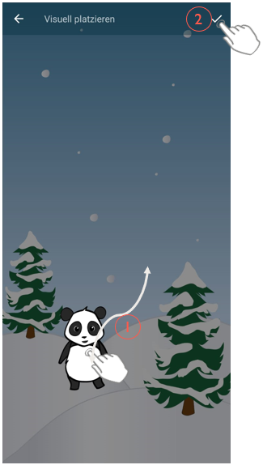

Catrobat ಮಾಧ್ಯಮ ಗ್ರಂಥಾಲಯವು ನಿನ್ನ ಯೋಜನೆಗಳಲ್ಲಿ ನೀನು ಬಳಸಬಹುದಾದ **ನಟರು**, **ಹಿನ್ನೆಲೆ**, ಧ್ವನಿಗಳು ಮತ್ತು ವಸ್ತುಗಳ ಸಂಗ್ರಹವಾಗಿದೆ. ನಿನ್ನ ಆಲೋಚನೆಗಳಿಗೆ ಸರಿಹೊಂದುವಂತೆ ಎಲ್ಲವನ್ನೂ ನೀನು ಕಸ್ಟಮೈಸ್ ಮಾಡಬಹುದು!

[ನಟ](#ಮಾಧ್ಯಮ-ಗ್ರಂಥಾಲಯದಿಂದ-ಹೊಸ-ನಟನನ್ನು-ಸೇರಿಸು)

[ಹಿನ್ನೆಲೆ](#ಮಾಧ್ಯಮ-ಗ್ರಂಥಾಲಯದಿಂದ-ಹಿನ್ನೆಲೆ-ಸೇರಿಸಿ)

[ಧ್ವನಿ](#ಮಾಧ್ಯಮ-ಗ್ರಂಥಾಲಯದಿಂದ-ಧ್ವನಿ-ಸೇರಿಸಿ)

[ವಸ್ತು](#ಮಾಧ್ಯಮ-ಗ್ರಂಥಾಲಯದಿಂದ-ಒಂದು-ವಸ್ತುವನ್ನು-ಸೇರಿಸಿ)

***

### ಮಾಧ್ಯಮ ಗ್ರಂಥಾಲಯದಿಂದ ಹೊಸ ನಟನನ್ನು ಸೇರಿಸು

ಪ್ರಾಜೆಕ್ಟ್ ವೀಕ್ಷಣೆಯಲ್ಲಿ, ಹೊಸ ನಟ ಅಥವಾ ವಸ್ತುವನ್ನು ಸೇರಿಸಲು + ಚಿಹ್ನೆಯನ್ನು [(ಹೆಚ್ಚಿನ ಮಾಹಿತಿ](../quick-start-guide/add-actors-and-objects.md) ಟ್ಯಾಪ್ ಮಾಡು. ಆಯ್ಕೆಮಾಡಿ “ರೂಪಗಳು”.

ನಿನ್ನ ಕಾರ್ಯಕ್ರಮದಲ್ಲಿ ನೀನು ಬಳಸಲು ಬಯಸುವ ನಟನನ್ನು ಆರಿಸು. ಆಕ್ಟರ್ (1) ಕ್ಕೆ ಟ್ಯಾಪ್ ಮಾಡಿ ಮತ್ತು ಅದನ್ನು ಡೌನ್ಲೋಡ್ ಮಾಡಿ (2).

ಈಗ ನೀನು ನಟನಿಗೆ ಹೊಸ ಹೆಸರನ್ನು (1) ನೀಡಬಹುದು ಮತ್ತು ಅದನ್ನು ನಿನ್ನ ಆಟದಲ್ಲಿ ದೃಶ್ಯವಾಗಿ ಇರಿಸಬಹುದು (2). ಇದರರ್ಥ ನೀನು ನಿನ್ನ ನಟನನ್ನು ನೇರವಾಗಿ ಪರದೆಯ ಮೇಲೆ ಚಲಿಸಬಹುದು. ನೀನು ತಕ್ಷಣವೇ ಯೋಜನೆಯಲ್ಲಿ ಅದನ್ನು ಎಲ್ಲಿ ಇರಿಸಲಾಗಿದೆ ಎಂಬುದನ್ನು ನೋಡುತ್ತೀರಿ. “ಸರಿ” ನಲ್ಲಿ ದೃಢೀಕರಿಸಿ.

ನಿನ್ನ ನಟನನ್ನು (1) ಇರಿಸಿ ಮತ್ತು ಚೆಕ್ಮಾರ್ಕ್ (2) ಮೂಲಕ ದೃಢೀಕರಿಸಿ.

***

### ಮಾಧ್ಯಮ ಗ್ರಂಥಾಲಯದಿಂದ ಹಿನ್ನೆಲೆ ಸೇರಿಸಿ

ಯೋಜನೆಯ ವೀಕ್ಷಣೆಯಲ್ಲಿ ಹಿನ್ನೆಲೆಗೆ ಹೋಗಿ. ನೋಟ ವಿಭಾಗಕ್ಕೆ ಬದಲಾಯಿಸಿ ಮತ್ತು ಹೊಸ ನೋಟವನ್ನು ([ಹೆಚ್ಚಿನ ಮಾಹಿತಿ](../quick-start-guide/add-background.md) ಸೇರಿಸಿ). “ರೂಪಗಳು” ನಲ್ಲಿ ಟ್ಯಾಪ್ ಮಾಡು.

ನಿನ್ನ ಕಾರ್ಯಕ್ರಮದಲ್ಲಿ ನೀನು ಬಳಸಲು ಬಯಸುವ ಸೂಕ್ತ ಹಿನ್ನೆಲೆಯನ್ನು ಆರಿಸು. ಹಿನ್ನೆಲೆ (1) ಕ್ಕೆ ಟ್ಯಾಪ್ ಮಾಡಿ ಮತ್ತು ಅದನ್ನು ಡೌನ್ಲೋಡ್ ಮಾಡಿ (2).

***

### ಮಾಧ್ಯಮ ಗ್ರಂಥಾಲಯದಿಂದ ಧ್ವನಿ ಸೇರಿಸಿ

ನಿನ್ನ ಹಿನ್ನೆಲೆ ಮತ್ತು ನಿನ್ನ ನಟರು ಅಥವಾ ವಸ್ತುಗಳಿಗೆ ಧ್ವನಿಗಳನ್ನು ಸೇರಿಸಬಹುದು. ಧ್ವನಿಯನ್ನು ಸೇರಿಸಲು ಬಯಸುವ ನಟ ಅಥವಾ ಹಿನ್ನೆಲೆ ಮೇಲೆ ಟ್ಯಾಪ್ ಮಾಡು. ಧ್ವನಿ ವೀಕ್ಷಣೆಗೆ ಹೋಗಿ + ಚಿಹ್ನೆಯನ್ನು ಟ್ಯಾಪ್ ಮಾಡು.

ಮಾಧ್ಯಮ ಗ್ರಂಥಾಲಯಕ್ಕೆ ಪ್ರವೇಶಿಸಲು “ಧ್ವನಿಗಳು” ಕ್ಲಿಕ್ ಮಾಡು.

ನಿನ್ನ ಕಾರ್ಯಕ್ರಮದಲ್ಲಿ ನೀನು ಬಳಸಲು ಬಯಸುವ ಸೂಕ್ತ ಧ್ವನಿಯನ್ನು ಆರಿಸು. ಧ್ವನಿಯನ್ನು (1) ಟ್ಯಾಪ್ ಮಾಡಿ ಮತ್ತು ಅದನ್ನು ಡೌನ್ಲೋಡ್ ಮಾಡಿ (2).

***

### ಮಾಧ್ಯಮ ಗ್ರಂಥಾಲಯದಿಂದ ಒಂದು ವಸ್ತುವನ್ನು ಸೇರಿಸಿ

Catrobat ಸಿದ್ಧ ವಸ್ತುಗಳನ್ನು ಡೌನ್ಲೋಡ್ ಮಾಡುವ ಅವಕಾಶವನ್ನು ನಿನಗೆ ನೀಡುತ್ತದೆ. ವಸ್ತುಗಳು ಒಂದು ಪಠ್ಯಕ್ರಮವನ್ನು ಒಳಗೊಂಡಿರುವ ಕೌಂಟ್ಡೌನ್ ನಂತಹ ಪ್ರತ್ಯೇಕ ಆಟದ ಅಂಶಗಳಾಗಿವೆ.

ನೀನು ನಟರಿಗೆ ಹೋಲುತ್ತದೆ ವಸ್ತುಗಳನ್ನು ಸೇರಿಸಲಾಗುತ್ತದೆ.

ಪ್ರಾಜೆಕ್ಟ್ ವೀಕ್ಷಣೆಯಲ್ಲಿ, ಹೊಸ ವಸ್ತುವನ್ನು ಸೇರಿಸಲು + ಚಿಹ್ನೆಯನ್ನು ([ಹೆಚ್ಚಿನ ಮಾಹಿತಿ](../quick-start-guide/add-actors-and-objects.md)) ಟ್ಯಾಪ್ ಮಾಡು.

ಆಯ್ಕೆಮಾಡಿ “ಲೈಬ್ರರಿ”.

ನಿನ್ನ ಪ್ರೋಗ್ರಾಂನಲ್ಲಿ ನೀನು ಬಳಸಲು ಬಯಸುವ ಒಂದು ವಸ್ತುವನ್ನು ಹುಡುಕಿ. ಆಬ್ಜೆಕ್ಟ್ (1) ಅನ್ನು ಟ್ಯಾಪ್ ಮಾಡಿ ಮತ್ತು ಅದನ್ನು ಡೌನ್ಲೋಡ್ ಮಾಡಿ (2).

ಈಗ ನೀನು ಆಬ್ಜೆಕ್ಟ್ಗೆ ಹೊಸ ಹೆಸರನ್ನು (1) ನೀಡಬಹುದು ಮತ್ತು ಅದನ್ನು ನಿನ್ನ ಆಟದಲ್ಲಿ ದೃಶ್ಯವಾಗಿ ಇರಿಸಬಹುದು (2). ಇದರರ್ಥ ನೀನು ನಿನ್ನ ವಸ್ತುಗಳನ್ನು ನೇರವಾಗಿ ಪರದೆಯ ಮೇಲೆ ಚಲಿಸಬಹುದು. ನೀನು ತಕ್ಷಣವೇ ಯೋಜನೆಯಲ್ಲಿ ಅದರ ಸ್ಥಾನವನ್ನು ನೋಡಬಹುದು. “ಸರಿ” ನಲ್ಲಿ ದೃಢೀಕರಿಸಿ.

ನಿನ್ನ ವಸ್ತುವನ್ನು (1) ಇರಿಸಿ ಮತ್ತು ಚೆಕ್ಮಾರ್ಕ್ (2) ಮೂಲಕ ದೃಢೀಕರಿಸಿ.
