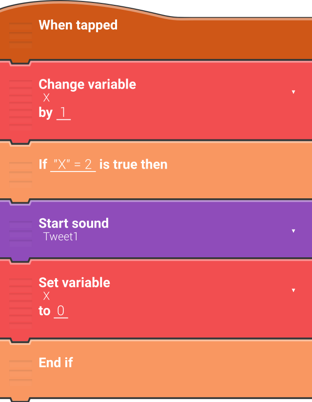

*ಒಂದು ಷರತ್ತು ನಿಜವಾಗಿದೆಯೆ ಎಂದು ಪರಿಶೀಲಿಸುತ್ತದೆ, ಮತ್ತು ಅದು ನಿಜವಾಗಿದ್ದರೆ, ಸೂಚನೆಗಳ ಗುಂಪನ್ನು ನಡೆಸುತ್ತದೆ. ಇದು ಹೇಳುವಂತೆಯೇ ಇದೆ, “ಇದು ನಿಜವಾಗಿದ್ದರೆ, ಇದನ್ನು ಮಾಡು.”*

ದೃಶ್ಯ ಪ್ರಾರಂಭವಾದಾಗ, ವೇರಿಯಬಲ್ X ಅನ್ನು 0 ಗೆ ಹೊಂದಿಸಲಾಗಿದೆ.

ಪ್ರಾಣಿಯನ್ನು ಈಗ ಟ್ಯಾಪ್ ಮಾಡಿದರೆ, ವೇರಿಯೇಬಲ್ X ಅನ್ನು 1 ರಷ್ಟು ಹೆಚ್ಚಿಸಲಾಗುತ್ತದೆ.

ಪ್ರೋಗ್ರಾಂ X ವೇರಿಯಬಲ್ ಮೌಲ್ಯ 2 ಗೆ ಸಮಾನವಾಗಿದೆಯೇ ಎಂದು ಪರಿಶೀಲಿಸುತ್ತದೆ.

ಈ ಸಂದರ್ಭದಲ್ಲಿ, ಧ್ವನಿ Tweet1 ಅನ್ನು ಆಡಲಾಗುತ್ತದೆ ಮತ್ತು ವೇರಿಯಬಲ್ X ಅನ್ನು 0 ಗೆ ಹೊಂದಿಸಲಾಗಿದೆ.
