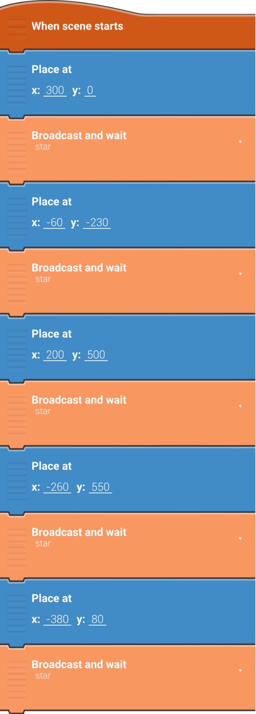

이 튜토리얼에서는 밤하늘(48.5 x 96.1mm)을 수놓는 법을 배워요.

반복문이 무엇이고 어떻게 동작하는지 이미 알고 있어야 해요.

이 튜토리얼에는 **[별](../embroidery-tutorials-beginner/star.md)** 튜토리얼이 도움이 될 수 있어요.

이미 메시지 기능에 익숙하다면 이 튜토리얼도 도움이 돼요.

아직 자수를 해 본 적이 없다면 [초급](../embroidery-tutorials-beginner/index.md) 시리즈의 자수 튜토리얼을 확인하세요.

더 많은 정보나 디자인 아이디어가 필요하면 다른 튜토리얼도 확인해 보세요.

*여기에서 튜토리얼을 PDF 형식으로 내려받을 수 있어요*:

[밤하늘](../../../media/embroidery-tutorials/Night-Sky.pdf)

### 1. 새 자수 오브젝트를 만들고 (See [자수 오브젝트 만들기](../embroidery-tutorials-beginner/create-embroidery-objects.md)) 다음 스크립트를 넣으세요:

### 2. 달

### 3. 별 하나

이 부분은 별 메시지가 보내질 때마다 실행돼요. 스크립트에도 추가하세요.

### 4. 모든 별

### 5. 실행 버튼을 눌러 디자인을 시작하세요!
