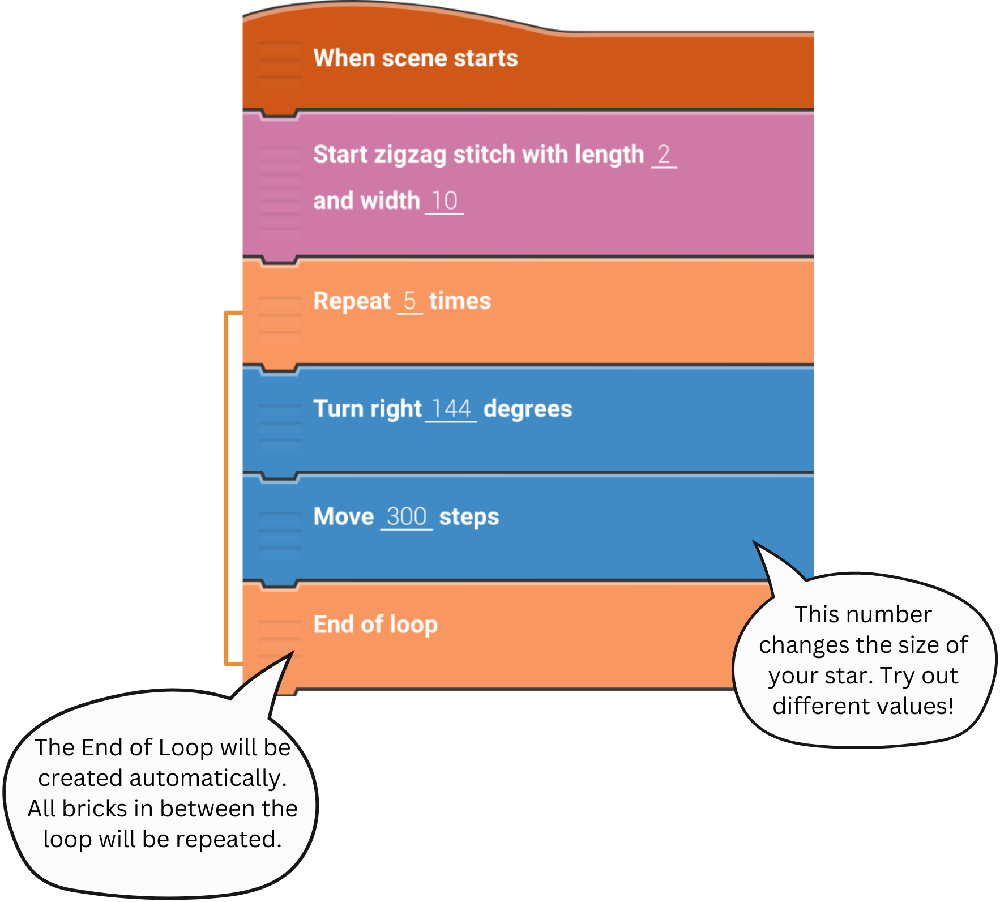

Šioje pamokoje sužinosi, kaip išsiuvinėti žvaigždę zigzago dygsniu (58,2 x 61,2 mm).

Turi jau mokėti sukurti naują objektą ir įdėti jame blokus. Jei dar reikia pagalbos, pažvelk į pamokas [Pradinių pamokų serijoje](../../game-tutorials/starter-tutorials/index.md). Be to, siuvinėjimo blokai jau turi būti įjungti. Kaip tai padaryti, sužinosi pamokoje **[Įjunk siuvinėjimo blokus](activate-embroidery-bricks.md)**.

Daugiau informacijos ar dizainų idėjų rasi kitose pamokose.

*Čia gali atsisiųsti pamoką PDF formatu*:

[Žvaigždė zigzagas](../../../media/embroidery-tutorials/Star-ZigZag.pdf)

### 1. Sukurk naują siuvinėjimo objektą (žr. [Sukurk siuvinėjimo objektus](create-embroidery-objects.md)).

### 2. Dabar pradėk ir žingsnis po žingsnio įdėk blokus į savo scenarijų.

### 3. Paspausk paleidimo mygtuką, kad pradėtum savo dizainą!
