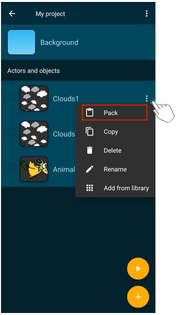

**Ранец** карактеристика во Pocket Code е практична функција која ви овозможува да **за чување и повторно користење** елементи како глумци (објекти), сценарии, изгледи или звуци **на проектите**. Тоа ви помага да го заштедите времето и да ги направите проектите поефективни.

Ракпакот е како дигитален простор за складирање каде што можеш да ги складирате различни елементи од твојот тековен проект. Откако ќе ги соберете во ракопаката, можеш да ги извлечете и вметнете овие елементи во други проекти.

### Како да го користам ракопакот за актери (објекти)?

**Паковајте фигури во ракопаката**

Одете во проектот на проектот од кој сакаш да ја упакнете фигурата во ракопаката.

Кликни на трите точки покрај сликата за да го отворите менуто за контекст и избери „Спакувај“.

Фигурата (вклучувајќи ја и нејзината изгледот, звуците и сценариите) ќе биде упакована во ракопаката.

**Додадете фигури од ракопаката**

Отвори го проектот каде што сакаш да ја внесете фигурата.

Во изгледот на проектот, кликни на симболот плюс и избери „Ранец“.

Сега ќе ги видите сите фигури и предмети што сте ги чувале во ракопаката. Натисни на трите точки и избери „Распакувај“.

***

### Како да го користам ракопакот за сценарио?

**Ставете сценарии во ракопаката:**

Оди до фигурата која го содржи сценаријот. Држете го бараниот сценарио во уредникот за сценарио.

Избери „Додај во ранецот“ од менюто за контекст.

Дајте му име на сценаријот и потврдете со Во ред.

Скриптото се чува и може да се користи во други проекти.

**Додадете скрипти од ракопаката:**

Натисни на актерот каде што сакаш да го внесеш сценаријот. Ќе ја видите сценариската област. Натискајте на трите точки за да го отворите менуто за контекст и натискајте на „Ранец“.

Сега можеш да ги видите сите сценарии кои веќе се во ракопаката. Натисни на трите точки покрај бараниот сценарио и избери „Распакувај“ од менюто за контекст.

Преку менюто за контекст, можеш да ги избришете скриптовите кои веќе не ви се потребни во ракопаката.

***

### Предности на ракопаката

- **Повторна употреба на проектите:** Фигурите, сценариите, звуците и изгледите можат да се создадат еднаш и повторно да се користат колку што е потребно.
- **Спење на време:** Не мора да создаваш фигури или сценарии одново секој пат.
- **Сгласност:** Елементите остануваат последователни кога ќе им требате на повеќе проекти.
