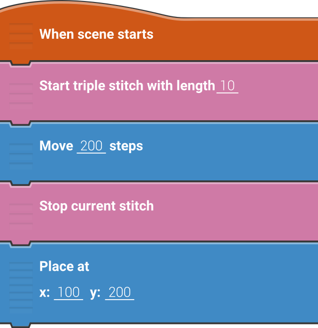

നിലവിലെ തൂക്കങ്ങൾ അവസാനിപ്പിക്കട്ടെ.

ഒരു ഓട്ടം, സിഗ്സാഗ് അല്ലെങ്കിൽ ട്രിപ്പിൾ സ്റ്റീച്ച് തുടങ്ങിയതിനുശേഷം നീലയുടെ സ്ഥാനം മാറ്റണമെങ്കിൽ ഈ കോഡ് ബ്ലോക്ക് നിനക്ക് ആവശ്യമായി വരും.

അല്ലാത്തപക്ഷം ഒരു അനാവശ്യ ഇടത്തരം തുന്നൽ സംഭവിക്കും.

