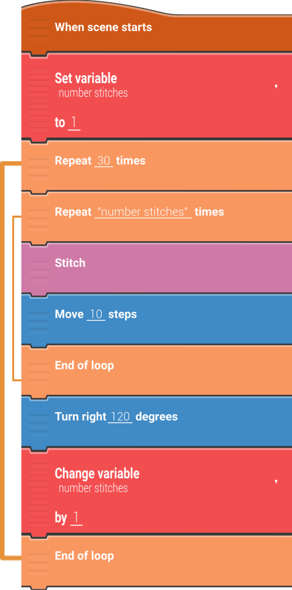

ഈ ട്യൂട്ടോറിയലിൽ, ഒരു ത്രികോണ സ്പിറൽ (50.2 x 58 മിമി) എങ്ങനെ ഇംബ്രോയിഡർ ചെയ്യാമെന്ന് നീ പഠിക്കും.

ഒരു ലൂപ്പ് എന്താണെന്നും അത് എങ്ങനെ പ്രവർത്തിക്കുന്നു എന്നും നീക്കറിയണം.

നീ ഇതുവരെ ഒന്നും ഇട്ടു കൂടാ എങ്കിൽ [തുടക്കക്കാരന്](../embroidery-tutorials-beginner/index.md) പരമ്പരയിലെ നുകം ട്യൂട്ടോറിയലുകൾ പരിശോധിക്കുക.

കൂടുതൽ വിവരങ്ങള് ക്കോ ഡിസൈന് നിർദ്ദേശങ്ങള് ക്കോ മറ്റ് ട്യൂട്ടോറിയലുകള് കാണുക.

*ഇവിടെ നിനക്ക് ട്യൂട്ടോറിയൽ PDF ഫോർമാറ്റിൽ ഡൌൺലോഡ് ചെയ്യാം*:

[ത്രികോണം-സ്പിറൽ](../../../media/embroidery-tutorials/Triangle-Spiral-1.pdf)

### 1. ഒരു പുതിയ ഇംബ്രോയിഡറി ഒബ്ജക്റ്റ് സൃഷ്ടിക്കുക (കാണുക [ഇംബ്രോയിഡറി വസ്തുക്കൾ സൃഷ്ടിക്കുക](../embroidery-tutorials-beginner/create-embroidery-objects.md)) താഴെ പറയുന്ന സ്ക്രിപ്റ്റ് ചേർക്കുകഃ:

### 2. നിന്റെ ഡിസൈൻ ആരംഭിക്കുന്നതിന് കളി ടാപ്പുചെയ്യുക!

പുതിയ വേരിയബിൾ സൃഷ്ടിക്കാൻ “പുതിയത്…” ടാപ്പുചെയ്യുക.

നീ വേരിയബിൾ കണ്ടെത്തും “degree” ഡാറ്റയില് .

