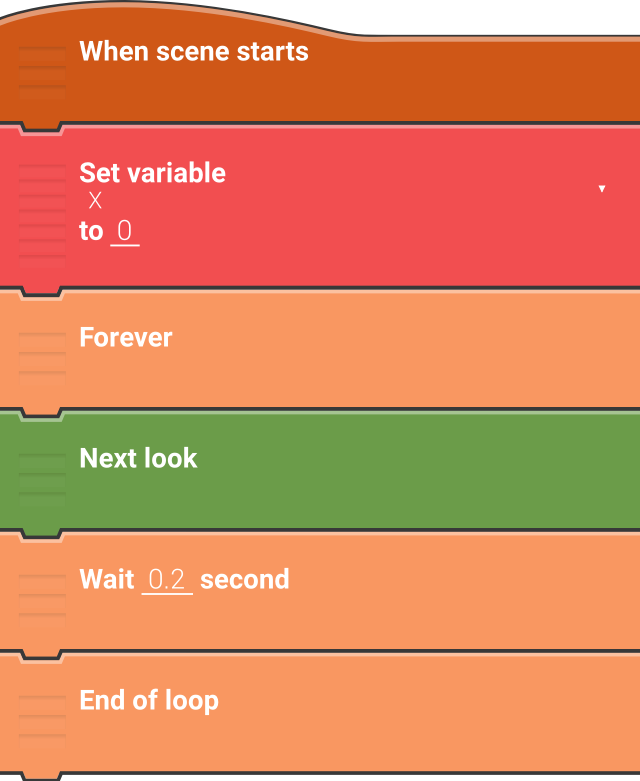

*ഒരു അവസ്ഥ ശരിയാണോ എന്ന് പരിശോധിക്കുന്നു, അത് ശരിയാണോ എന്ന് പരിശോധിക്കുന്നു, ഒരു കൂട്ടം നിർദ്ദേശങ്ങൾ പ്രവർത്തിപ്പിക്കുന്നു. ഇത് പറയുന്നത് പോലെ തന്നെ, “ഇത് സത്യമാണെങ്കില് , ഇതെന്താ ചെയ്യുക.”*

രംഗം തുടങ്ങുമ്പോൾ, പരിവർത്തന X 0 ആയി സജ്ജമാക്കുന്നു.

മൃഗത്തെ ഇപ്പോൾ ടാപ്പുചെയ്യുകയാണെങ്കിൽ, വേരിയബിൾ X 1 വർദ്ധിപ്പിക്കുന്നു.

പരിപാടി X വേരിയബിൾ 2 എന്ന മൂല്യത്തിന് തുല്യമാണോ എന്ന് പരിശോധിക്കുന്നു.

ഈ സാഹചര്യത്തിൽ, ശബ്ദം Tweet1 പ്ലേ ചെയ്യുകയും വേരിയബിൾ X 0 ആയി സജ്ജമാക്കുകയും ചെയ്യുന്നു.
