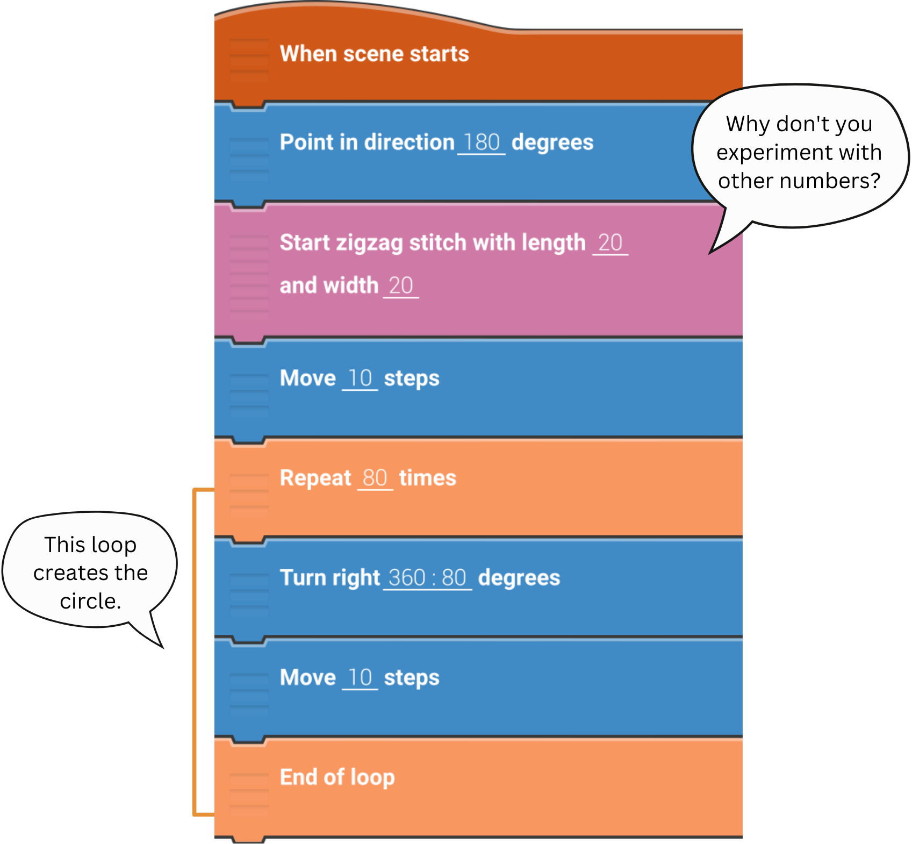

Dalam tutorial ini, kamu akan belajar cara menyulam bulatan dengan jahitan zigzag (54.7x 54.8mm).

Kamu sepatutnya sudah tahu cara mencipta objek baharu dan memasukkan blok di sana. Jangan segan untuk lihat tutorial dalam [siri Permulaan](../../game-tutorials/starter-tutorials/index.md) jika kamu masih perlukan bantuan. Selain itu, blok sulaman mesti sudah diaktifkan. Kamu boleh tahu cara melakukannya dalam tutorial **[Aktifkan blok sulaman](activate-embroidery-bricks.md)**.

Untuk maklumat lanjut atau cadangan reka bentuk, lihat tutorial yang lain.

*Di sini kamu boleh muat turun tutorial dalam format PDF*:

[Bulatan Zigzag](../../../media/embroidery-tutorials/Circle-Zigzag.pdf)

### 1. Cipta objek sulaman baharu (lihat [Cipta objek sulaman](create-embroidery-objects.md)).

### 2. Sekarang mulakan dan masukkan blok langkah demi langkah ke dalam skrip kamu.

### 3. Ketik main untuk mula reka bentuk kamu!

Lihat tutorial **[Bulatan](circle.md)** untuk maklumat lanjut tentang cara menyulam bulatan.
