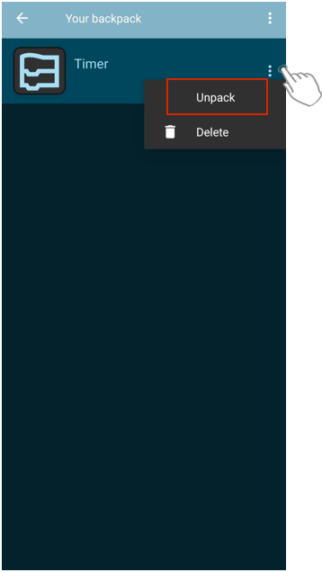

Ciri **beg galas** dalam Pocket Code ialah fungsi praktikal yang membolehkan kamu **menyimpan dan menggunakan semula** elemen seperti pelakon (objek), skrip, rupa atau bunyi **merentasi projek**. Ia membantu kamu menjimatkan masa dan menjadikan projek kamu lebih cekap.

Beg galas ialah seperti ruang storan digital tempat kamu boleh menyimpan pelbagai elemen daripada projek semasa kamu. Setelah disimpan dalam beg galas, kamu boleh mengambil dan memasukkan elemen ini ke dalam projek lain.

### Bagaimana saya guna beg galas untuk pelakon (objek)?

**Kemaskan watak ke dalam beg galas**

Pergi ke paparan projek bagi projek yang mana kamu mahu mengemaskan watak ke dalam beg galas.

Klik pada tiga titik di sebelah watak untuk membuka menu konteks dan pilih “Kemas.”

Watak itu (termasuk rupa, bunyi dan skripnya) akan dikemas ke dalam beg galas.

**Tambah watak daripada beg galas**

Buka projek tempat kamu mahu memasukkan watak itu.

Dalam paparan projek, ketik simbol tambah dan pilih “Beg galas.”

Kini kamu akan nampak semua watak dan objek yang telah kamu simpan dalam beg galas. Ketik pada tiga titik dan pilih “Keluarkan.”

***

### Bagaimana saya guna beg galas untuk skrip?

**Letakkan skrip dalam beg galas:**

Pergi ke watak yang mengandungi skrip itu. Tekan dan tahan skrip yang dikehendaki dalam editor skrip.

Pilih “Tambah ke beg galas” daripada menu konteks.

Beri skrip itu nama dan sahkan dengan OK.

Skrip disimpan dan boleh digunakan dalam projek lain.

**Tambah skrip daripada beg galas:**

Ketik pada pelakon tempat kamu mahu memasukkan skrip. Kamu akan nampak kawasan skrip. Ketik pada tiga titik untuk membuka menu konteks dan ketik “Beg galas”.

Kini kamu boleh melihat semua skrip yang sudah ada dalam beg galas kamu. Ketik pada tiga titik di sebelah skrip yang dikehendaki dan pilih “Keluarkan” daripada menu konteks.

Melalui menu konteks, kamu boleh memadam skrip yang tidak diperlukan lagi dalam beg galas kamu.

***

### Faedah beg galas

- **Boleh guna semula merentasi projek:** Watak, skrip, bunyi dan rupa boleh dicipta sekali dan digunakan semula seberapa kerap yang diperlukan.
- **Menjimatkan masa:** Kamu tidak perlu mencipta watak atau skrip semula setiap kali.
- **Konsisten:** Elemen kekal sama apabila kamu memerlukannya merentasi beberapa projek.
