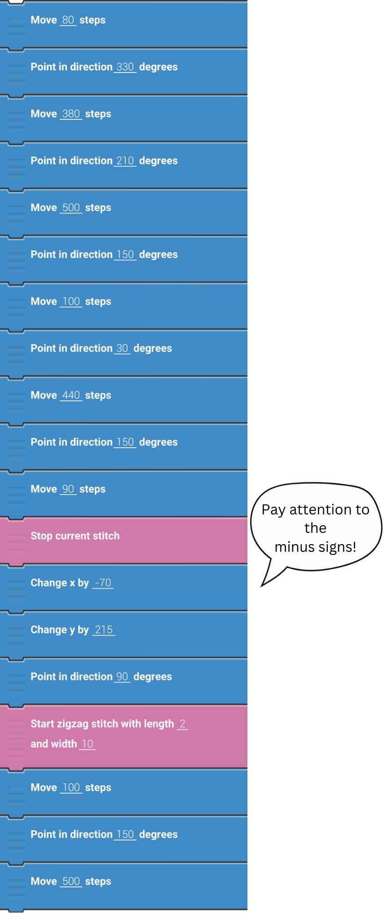

In deze tutorial leer je hoe je een Penrose-driehoek borduurt (105,6 x 120,6 mm).

Bekijk de borduurtutorials uit de reeks [voor beginners](../embroidery-tutorials-beginner/index.md) als je nog nooit iets hebt geborduurd.

Voor meer informatie of ontwerpsuggesties kun je de andere tutorials bekijken.

*Hier kun je de tutorial als PDF downloaden*:

[Penrose-driehoek](../../../media/embroidery-tutorials/Penrose-Triangle.pdf)

### 1. Maak een nieuw borduurobject (zie [Borduurobjecten maken](../embroidery-tutorials-beginner/create-embroidery-objects.md)) en voeg het volgende script toe:

### 2. Eerste deel:

### 3. Tweede deel

### 4. Tik op afspelen om je ontwerp te starten!
