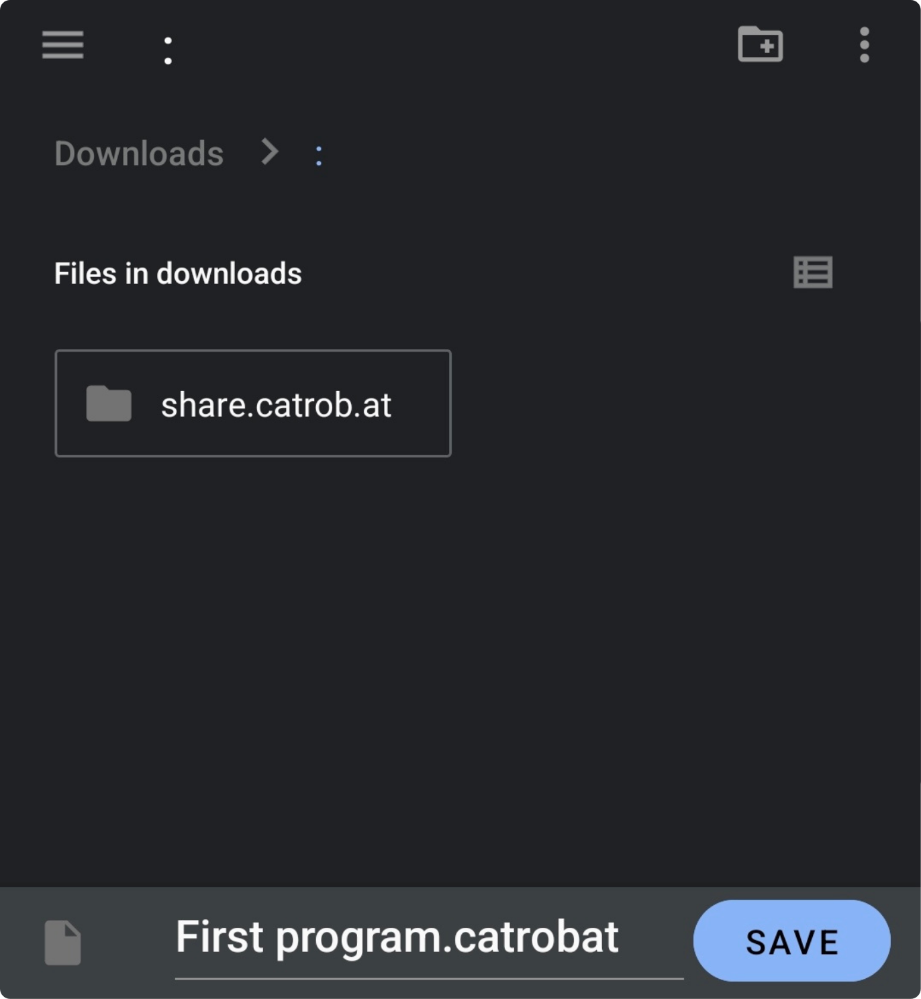

In deze tutorial leer je hoe je je gemaakte projecten met vrienden of de hele Catrobat-gemeenschap deelt.

\
In deze tutorial leer je hoe je je gemaakte projecten met vrienden of de hele Catrobat-gemeenschap deelt.\
[Afbeelding openen](../../../media/game-tutorials/Upload-and-Share.png)

Voor deze tutorial heb je al een eigen project nodig dat je wilt delen. Weet je nog niet hoe je een project maakt? Bekijk dan de tutorial **[Nieuw project](new-project.md)** om te leren hoe het werkt.

*Hier kun je de tutorial als PDF downloaden:*

[PDF openen](../../../media/game-tutorials/Upload-and-Share.pdf)

### 1. Projectopties

Als je je project wilt uploaden of delen, moet je je project openen.

\
Tik daarna op de drie puntjes rechtsboven en tik op “Projectopties”.\
[Afbeelding openen](../../../media/game-tutorials/Upload-and-Share.png)

### 2. Projectopties

Nu kun je de naam veranderen, een beschrijving toevoegen en allerlei instellingen maken.

Je hebt ook twee opties: “Programma uploaden” en “Project exporteren”.

\
Die worden in de volgende stappen uitgelegd.\
[Afbeelding openen](../../../media/game-tutorials/Upload-and-Share-1.png)

### 3. Programma uploaden

Wil je je project naar de Catrobat-Share uploaden, zodat de hele gemeenschap het kan zien? Kies dan *Programma uploaden*.

### 4. Programma uploaden

Als je op deze knop tikt om je project naar de Share te uploaden, moet je een account maken, als je dat nog niet hebt gedaan. Je kunt ook inloggen met Google. Als je bent ingelogd, moet je je project een naam geven en een beschrijving schrijven. Daarna kies je maximaal drie categorieën die het best bij je programma passen.

\
Tik daarna op “volgende” om je programma te uploaden.\
[Afbeelding openen](../../../media/game-tutorials/Upload-and-Share-2.png)

### 5. Project exporteren

Wil je je project met vrienden delen? Kies dan *Project exporteren*.

### 6. Project exporteren

Met deze knop kun je een .catrobat-bestand opslaan. Dat kun je privé met je vrienden delen.

\
Je slaat het op in de bestandsverkenner van je apparaat en deelt het zo.\
[Afbeelding openen](../../../media/game-tutorials/Upload-and-Share-3.png)

Gelukt! Je hebt je eerste programma gedeeld!

Hulp of inspiratie nodig voor volgende projecten? Bekijk dan onze tutorials op verschillende niveaus (Beginner/Gemiddeld/Gevorderd).
