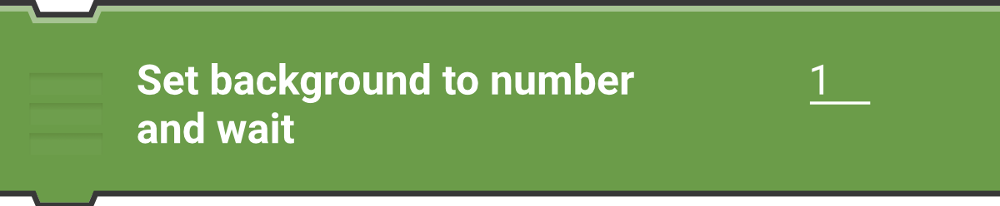

Dit blok verandert de achtergrond in een bepaalde achtergrond, op basis van de plek in de lijst met achtergronden. Daarna wacht het tot de wisseling klaar is voordat het script verdergaat. Het is alsof je in een toneelstuk een bepaald decor uit een lijst kiest en de actie even stilzet tot het nieuwe decor helemaal klaar is.
