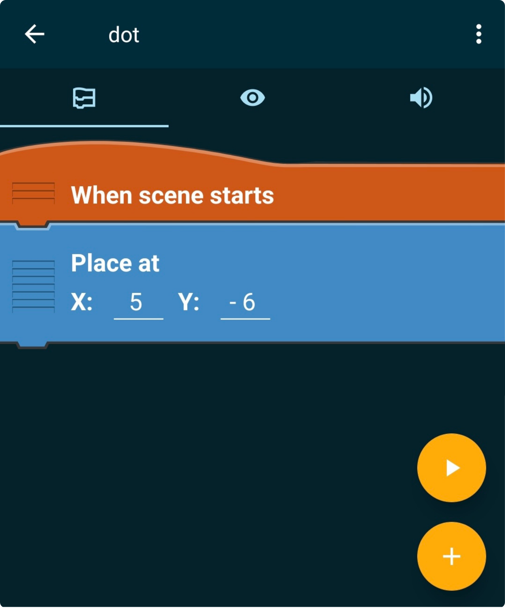

I denne veiledningen lærer du hvor du finner ulike klosser for å programmere et objekt. I tillegg får du en god oversikt over kategoriene av klosser.

::project{id=6ac78173-445a-4280-8b8a-ea6b1e8e4af5}

For å sette inn klosser og programmere objektet ditt, bør du allerede ha laget et prosjekt med et objekt. Hvis du trenger hjelp med dette, kan du se på veiledningen **[Nytt objekt](new-object.md)**.

*Her kan du laste ned veiledningen i PDF-format:*

[Første klosser](../../../media/game-tutorials/First-Bricks.pdf)

### 1. Åpne et eksisterende objekt

Først må du åpne prosjektet ditt. Du bør allerede ha laget et objekt (hvis ikke, se veiledningen **[Nytt objekt](new-object.md)**). Nå kan du trykke på objektets navn.

### 2. Eksisterende klosser

Deretter ser du at det allerede finnes noen klosser. Disse klossene ble laget da vi plasserte objektet visuelt.

Disse klossene gjør ikke mer enn å plassere objektet vårt akkurat der vi valgte i begynnelsen, når prosjektet starter. Du kan også endre denne posisjonen når som helst her.

### 3. Sett inn klosser

Nå kan du lage flere klosser ved å trykke på den gule pluss-knappen nederst til høyre. Du ser da et nytt vindu med flere kategorier av klosser. Disse kategoriene forklares i neste steg.

### 4. Kategorier av klosser

Dette er de ulike kategoriene av klosser:

### 5. Sett inn den første klossen

Til våre første klosser vil vi bruke klossen «Gli 1 sekund til x: y:». Du finner den i kategorien «Bevegelse». Med formelredigeringen kan du endre antall sekunder og posisjonen X og Y.

### 6. Plasser klossen

Plasser klossen nederst i programmet ditt, og kjør programmet for første gang. Det gjør du med den gule avspillingsknappen.

### 7. Du klarte det! Du satte inn din første kloss.

Nå har du programmert ditt første objekt!

Hvis du vil dele prosjektet ditt med vennene dine, kan du se på veiledningen **[Last opp og del](upload-and-share.md)**, der det forklares nøyaktig hvordan det fungerer. Ellers kan du allerede begynne på ditt første eget prosjekt. Hvis du trenger hjelp eller inspirasjon, er du velkommen til å se på veiledningene fra nybegynnerserien.

Du finner mer informasjon om alle klossene [her](../../../reference/)!
