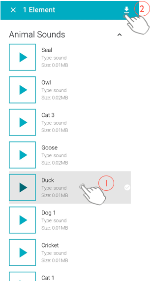

Catrobats mediebibliotek er en samling av **figurer**, **bakgrunner**, lyder og objekter som du kan bruke i prosjektene dine. Du kan tilpasse alt slik at det passer til ideene dine!

[Figur](#legg-til-en-ny-figur-fra-mediebiblioteket)

[Bakgrunn](#legg-til-en-bakgrunn-fra-mediebiblioteket)

[Lyd](#legg-til-en-lyd-fra-mediebiblioteket)

[Objekt](#legg-til-et-objekt-fra-mediebiblioteket)

***

### Legg til en ny figur fra mediebiblioteket

I prosjektvisningen trykker du på plusstegnet [(mer informasjon)](../quick-start-guide/add-actors-and-objects.md) for å legge til en ny figur eller et nytt objekt. Velg «Drakter».

Velg en figur du vil bruke i programmet ditt. Trykk på figuren (1) og last den ned (2).

Nå kan du gi figuren et nytt navn (1) og plassere den visuelt i spillet ditt (2). Det betyr at du kan flytte figuren direkte på skjermen. Du ser med en gang hvor den står i prosjektet. Bekreft med «OK».

Plasser figuren (1) og bekreft med haken (2).

***

### Legg til en bakgrunn fra mediebiblioteket

Gå til bakgrunnen i prosjektvisningen. Bytt til drakt-delen og legg til en ny drakt ([mer informasjon](../quick-start-guide/add-background.md)). Trykk på «Drakter».

Velg en bakgrunn som passer og som du vil bruke i programmet ditt. Trykk på bakgrunnen (1) og last den ned (2).

***

### Legg til en lyd fra mediebiblioteket

Du kan legge til lyder både på bakgrunnen og på figurene eller objektene dine. Trykk på figuren eller bakgrunnen der du vil legge til lyden. Gå til lydvisningen og trykk på plusstegnet.

Trykk på «Lyder» for å åpne mediebiblioteket.

Velg en lyd som passer og som du vil bruke i programmet ditt. Trykk på lyden (1) og last den ned (2).

***

### Legg til et objekt fra mediebiblioteket

Catrobat lar deg laste ned ferdige objekter. Objekter er enkelte spillelementer, for eksempel en nedtelling, som allerede har et skript.

Du legger til objekter på samme måte som figurer.

I prosjektvisningen trykker du på plusstegnet ([mer informasjon](../quick-start-guide/add-actors-and-objects.md)) for å legge til et nytt objekt.

Velg «Bibliotek».

Søk etter et objekt du vil bruke i programmet ditt. Trykk på objektet (1) og last det ned (2).

Nå kan du gi objektet et nytt navn (1) og plassere det visuelt i spillet ditt (2). Det betyr at du kan flytte objektet direkte på skjermen. Du ser med en gang hvor det står i prosjektet. Bekreft med «OK».

Plasser objektet (1) og bekreft med haken (2).
