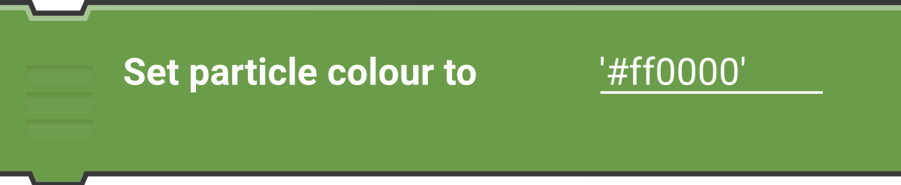

ਇਹ ਕੋਡ ਬਲਾਕ ਅਦਾਕਾਰ ਦੁਆਰਾ ਪ੍ਰਸਾਰਿਤ ਕੀਤੇ ਗਏ ਕਣਾਂ ਦੇ ਰੰਗ ਨੂੰ ਬਦਲਦਾ ਹੈ। ਇਹ ਪਾਰਟੀ ਦੇ ਪੌਪਰ ਵਿੱਚ ਕਨਫੈਟੀ ਦਾ ਰੰਗ ਬਦਲਣ ਵਰਗਾ ਹੈ।

ਇੱਕ ਹੈਕਸ ਕੋਡ ਰੰਗ ਹੈਕਸੇਡੀਕਲ ਮੁੱਲਾਂ ਦੀ ਵਰਤੋਂ ਕਰਕੇ ਰੰਗਾਂ ਨੂੰ ਦਰਸਾਉਣ ਦਾ ਇੱਕ ਤਰੀਕਾ ਹੈ. ਇਹ ਛੇ ਅੱਖਰਾਂ ਤੋਂ ਬਣਿਆ ਹੋਇਆ ਹੈ, ਜੋ ਨੰਬਰ (0-9) ਜਾਂ ਅੱਖਰ (ਏ-ਐਫ) ਹੋ ਸਕਦੇ ਹਨ। ਕੋਡ ਆਮ ਤੌਰ 'ਤੇ ਸ਼ੁਰੂ ਵਿੱਚ ਇੱਕ “#” ਨਾਲ ਲਿਖਿਆ ਜਾਂਦਾ ਹੈ, ਜਿਵੇਂ ਕਿਃ `#RRGGBB`.

- ਪਹਿਲੇ ਦੋ ਅੱਖਰ (`RR`) ਰੰਗ ਦੇ ਲਾਲ ਭਾਗ ਨੂੰ ਦਰਸਾਉਂਦੇ ਹਨ.
- ਅਗਲੇ ਦੋ ਅੱਖਰ (`GG`) ਹਰੇ ਭਾਗ ਨੂੰ ਦਰਸਾਉਂਦੇ ਹਨ।
- ਪਿਛਲੇ ਦੋ ਅੱਖਰ (`BB`) ਨੀਲੇ ਭਾਗ ਨੂੰ ਦਰਸਾਉਂਦੇ ਹਨ.

ਹਰੇਕ ਜੋੜਾ ਅੱਖਰ `00` (ਜੋ ਕਿ ਉਸ ਰੰਗ ਦਾ ਕੋਈ ਮਤਲਬ ਨਹੀਂ ਹੈ) ਤੋਂ ਲੈ ਕੇ `FF` ਤੱਕ ਹੋ ਸਕਦਾ ਹੈ (ਜੋ ਕਿ ਉਸ ਰੰਗ ਦੀ ਵੱਧ ਤੋਂ ਵੱਧ ਮਾਤਰਾ ਦਾ ਮਤਲਬ ਹੈ). ਉਦਾਹਰਨ ਲਈਃ:

`#000000` ਕਾਲਾ ਹੈ (ਕੋਈ ਰੰਗ ਨਹੀਂ).

`#FF0000` ਸ਼ੁੱਧ ਲਾਲ ਹੈ.

`#00FF00` ਸ਼ੁੱਧ ਹਰੀ ਹੈ.

`#0000FF` ਸ਼ੁੱਧ ਨੀਲਾ ਹੈ.

`#FFFFFF` ਚਿੱਟਾ ਹੈ (ਵੱਧ ਤੋਂ ਵੱਧ ਲਾਲ, ਹਰਾ ਅਤੇ ਨੀਲਾ).
