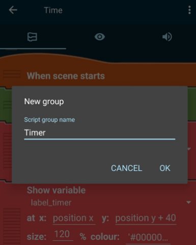

Funkcja **plecak** w Pocket Code to przydatna opcja, która pozwala **zapisać i ponownie użyć** elementów, takich jak postacie (obiekty), skrypty, wyglądy albo dźwięki, **w różnych projektach**. Pomaga oszczędzać czas i sprawia, że twoje projekty są lepsze.

Plecak jest jak cyfrowa przestrzeń na przechowanie, w której możesz trzymać różne elementy z bieżącego projektu. Kiedy coś zapiszesz w plecaku, możesz to wyjąć i wstawić do innych projektów.

### Jak używać plecaka do postaci (obiektów)?

**Spakuj postacie do plecaka**

Przejdź do widoku projektu, z którego chcesz spakować postać do plecaka.

Kliknij trzy kropki obok postaci, żeby otworzyć menu kontekstowe, i wybierz „Spakuj”.

Postać (razem z jej wyglądami, dźwiękami i skryptami) zostanie spakowana do plecaka.

**Dodaj postacie z plecaka**

Otwórz projekt, do którego chcesz wstawić postać.

W widoku projektu dotknij znaku plus i wybierz „Plecak”.

Zobaczysz teraz wszystkie postacie i obiekty, które zapisałeś w plecaku. Dotknij trzy kropki i wybierz „Wypakuj”.

***

### Jak używać plecaka do skryptów?

**Wkładanie skryptów do plecaka:**

Przejdź do postaci, która ma skrypt. Przytrzymaj wybrany skrypt w edytorze skryptów.

Wybierz „Dodaj do plecaka” z menu kontekstowego.

Nadaj skryptowi nazwę i potwierdź przyciskiem OK.

Skrypt jest zapisany i można go używać w innych projektach.

**Dodawanie skryptów z plecaka:**

Dotknij postaci, do której chcesz wstawić skrypt. Zobaczysz obszar skryptów. Dotknij trzy kropki, żeby otworzyć menu kontekstowe, i dotknij „Plecak”.

Zobaczysz teraz wszystkie skrypty, które już są w twoim plecaku. Dotknij trzy kropki obok wybranego skryptu i wybierz „Wypakuj” z menu kontekstowego.

Przez menu kontekstowe możesz usunąć z plecaka skrypty, których już nie potrzebujesz.

***

### Zalety plecaka

- **Wielokrotne użycie w różnych projektach:** Postacie, skrypty, dźwięki i wyglądy możesz stworzyć raz i używać ich tyle razy, ile potrzebujesz.
- **Oszczędność czasu:** Nie musisz za każdym razem tworzyć postaci ani skryptów od nowa.
- **Spójność:** Elementy pozostają takie same, kiedy potrzebujesz ich w kilku projektach.
