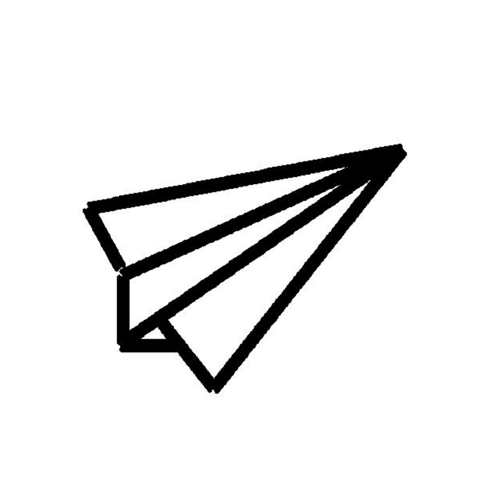

په دې درس کې به د کاغذي الوتکه ګنډل زده کړې (58.2 x 80.7mm).

که مخکې دې ګلدوزي نه وي کړې، [د ګلدوزۍ د پیل درسونه](../embroidery-tutorials-beginner/index.md) وګوره.

د نورو معلوماتو او د رسم د مفکورو لپاره نور درسونه وګوره.

*دا درس دلته د PDF په بڼه ښکته کولی شې*:

[د کاغذ الوتکه](../../../media/embroidery-tutorials/Paper-Plane.pdf)

### 1. د ګلدوزۍ نوی څیز جوړ کړه (د [د ګلدوزۍ څیزونه جوړ کړه](../embroidery-tutorials-beginner/create-embroidery-objects.md) درس وګوره) او د کوډ دا لړۍ ورزیاته کړه:

### 2. د رسم د پیل لپاره «چلول» کېکاږه!
