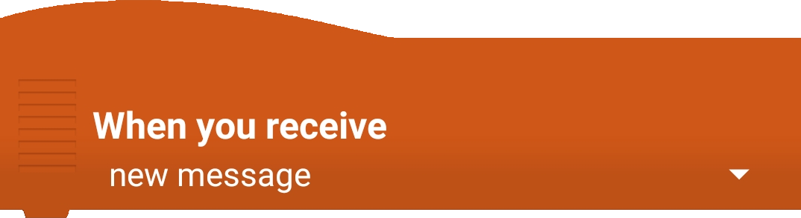

د دې بلاک سره ستا شی د ځانګړي خپرونې پیغام لپاره اوري او بیا سکریپټ پرمخ وړي کله چې پیغام ترلاسه کیږي. د شیانو تر منځ د اړیکو لپاره ګټور او دوی ته یې ووایی چې کله یو څه وکړي.

**ولې د خپرونو پیغامونه لیږل کیږي؟**

د پیغامونو سره کولی شې په یوه صحنه کې د مختلفو شیانو ترمنځ اړیکه ونیسئ او تعامل وکړئ. دا یو شی ته اجازه ورکوي چې ټولو نورو شیانو ته پیغام واستوي، او ترلاسه کونکي شیان کولی شي بیا د دې پیغام غبرګون یا ځواب ووایی.

دا پیغامونه په سکرین کې دي **په نښه نه کېږي**! که غواړې پیغامونه وښایاست، د «بڼې» کټګورۍ کې د کوډ بلاکونو کار واخلئ!

**دا څنګه کار کوي؟**

- *د لېږدونکي شی:* د لیږونکي څیز د *«پیغام خپور کړئ»* بلاک په کارولو سره اړیکه پیلوي. دا بلاک په صحنه کې ټولو نورو شیانو (او همدارنګه د شالید) ته د پیغام لیږلو لپاره کارول کیږي.
- *د ترلاسه کولو شی:* د ترلاسه کونکي شی هغه دی چې پیغامونه اوري او ځواب ورکوي. دا د *«کله چې دا پیغام ترلاسه کړئ»* بلاک کاروي ترڅو ومومي چې کله یو ځانګړی پیغام ترلاسه کیږي.
- *د پیغامونو اداره کول:* کله چې ترلاسه کوونکي څیز پیغام ترلاسه کوي، دا به ټول بلاکونه چې د *«کله چې دا پیغام ترلاسه کړئ»* بلاک لاندې دي اجرا کړي. دا تا ته اجازه درکوي چې دودیز چلند یا کړنې تعریف کړئ کله چې یو ځانګړی پیغام ترلاسه کیږي.
