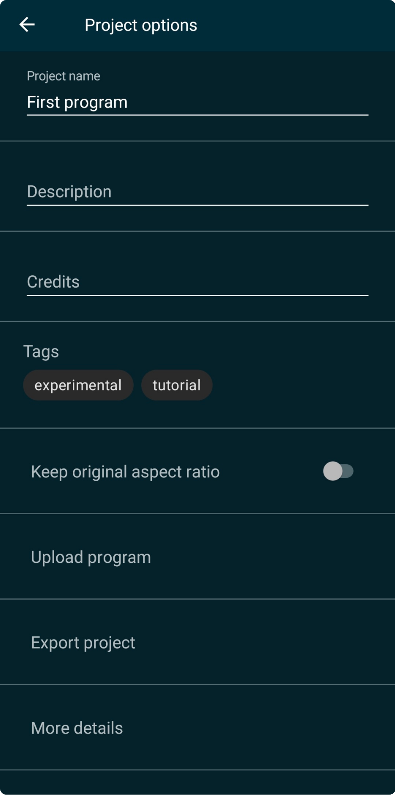

Neste tutorial, você aprende a compartilhar os projetos que criou com seus amigos ou com toda a comunidade Catrobat.

\
Neste tutorial, você aprende a compartilhar os projetos que criou com seus amigos ou com toda a comunidade Catrobat.\
[Abrir imagem](../../../media/game-tutorials/Upload-and-Share.png)

Para este tutorial, você já precisa ter um projeto seu que quer compartilhar. Se ainda não sabe criar um projeto, veja o tutorial **[Novo projeto](new-project.md)** para aprender como se faz.

*Aqui você pode baixar o tutorial em PDF:*

[Abrir PDF](../../../media/game-tutorials/Upload-and-Share.pdf)

### 1. Opções do projeto

\
Se você quer enviar ou compartilhar o seu projeto, abra o projeto, toque nos três pontinhos no canto de cima à direita e depois em “Opções do projeto”.\
[Abrir imagem](../../../media/game-tutorials/Upload-and-Share.png)

### 2. Opções do projeto

Agora você pode mudar o nome, escrever uma descrição e mudar várias configurações.

Você também tem duas opções: “Enviar projeto” e “Exportar projeto”.

\
Elas são explicadas nos próximos passos.\
[Abrir imagem](../../../media/game-tutorials/Upload-and-Share-1.png)

### 3. Enviar projeto

Se você quer enviar o seu projeto para o Catrobat Share, para que toda a comunidade possa ver, escolha *Enviar projeto*.

### 4. Enviar projeto

Quando você toca nesse botão para enviar o seu projeto para o Share, você precisa criar uma conta, se ainda não tiver uma. Você também pode entrar com o Google. Depois de entrar, dê um nome ao seu projeto e escreva uma descrição. Depois escolha até três categorias que combinam melhor com o seu programa.

\
Depois toque em “Próximo” para enviar o seu programa.\
[Abrir imagem](../../../media/game-tutorials/Upload-and-Share-2.png)

### 5. Exportar projeto

Se você quer compartilhar o seu projeto com seus amigos, escolha *Exportar projeto*.

### 6. Exportar projeto

Com esse botão, você salva um arquivo .catrobat que pode mandar só para os seus amigos.

\
Você pode salvar ele nos arquivos do seu aparelho e compartilhar de lá.\
[Abrir imagem](../../../media/game-tutorials/Upload-and-Share-3.png)

Você conseguiu! Você compartilhou o seu primeiro programa!

Se precisar de ajuda ou de ideias para os próximos projetos, veja os nossos tutoriais de vários níveis (iniciante/médio/avançado).
