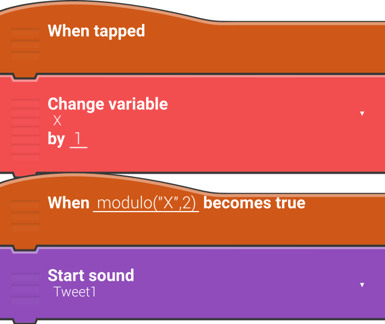

*Espera até o valor ou a função ficar verdadeira e depois começa o script.*

Quando a cena começa, a variável X recebe o valor 0.

Quando você toca no animal, X aumenta em 1.

Quando X módulo 2 fica verdadeiro, ou seja, quando X é um número ímpar, o som Tweet1 toca.
